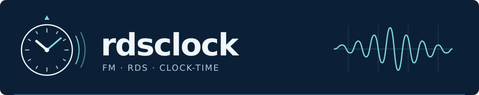
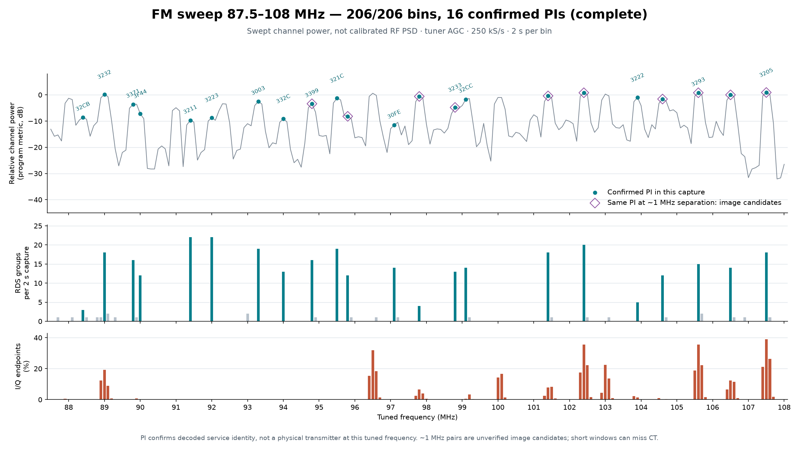
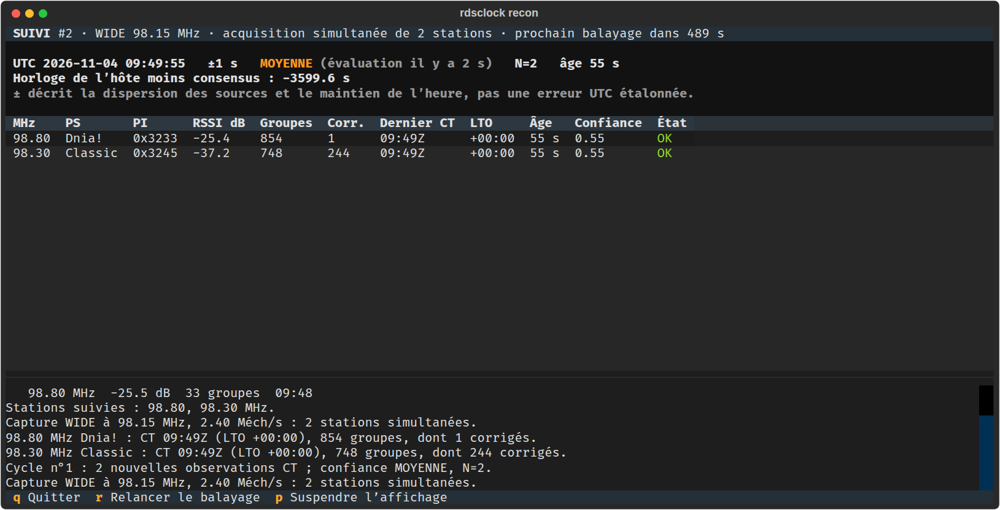
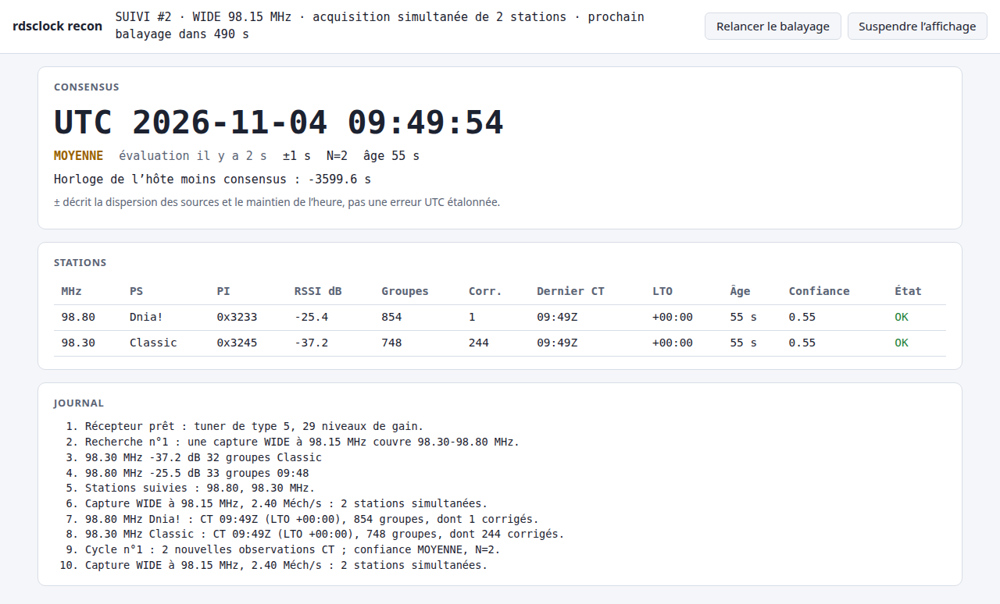
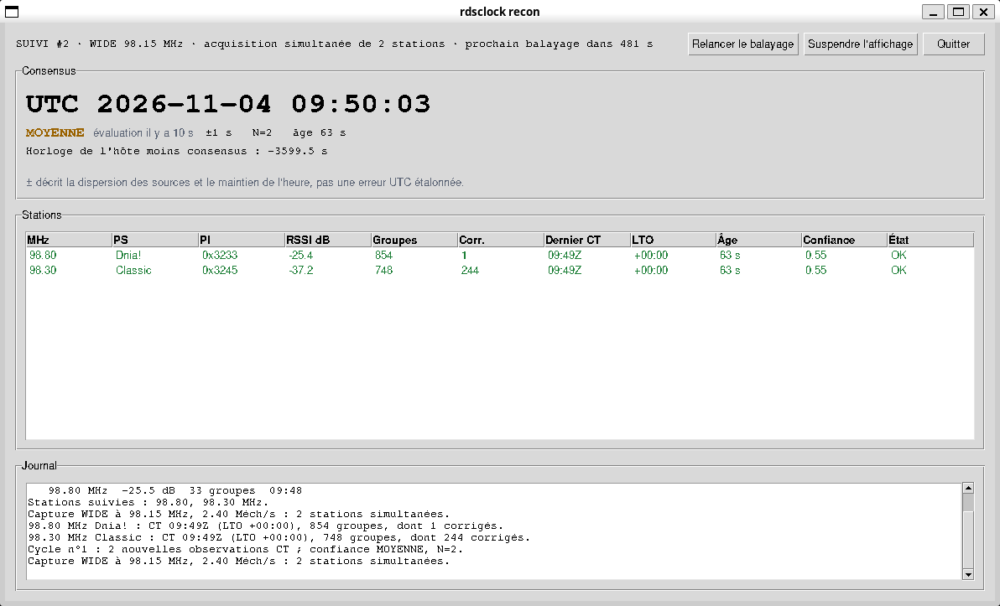
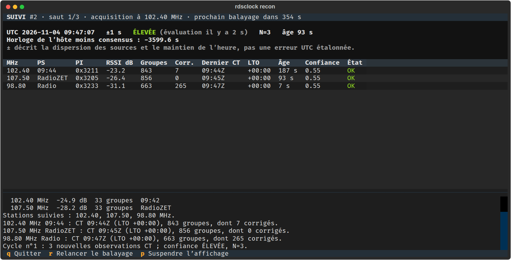
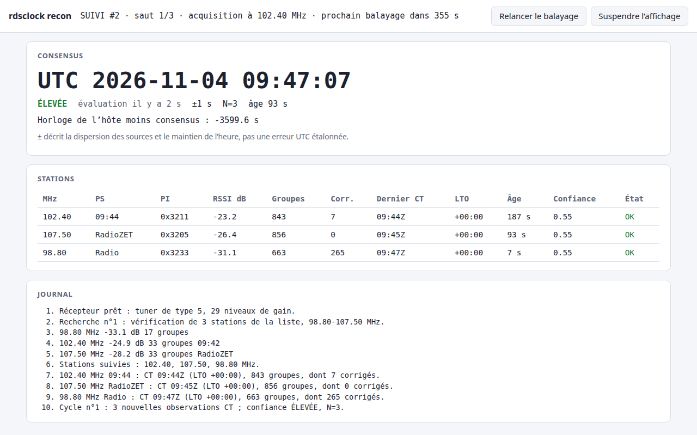
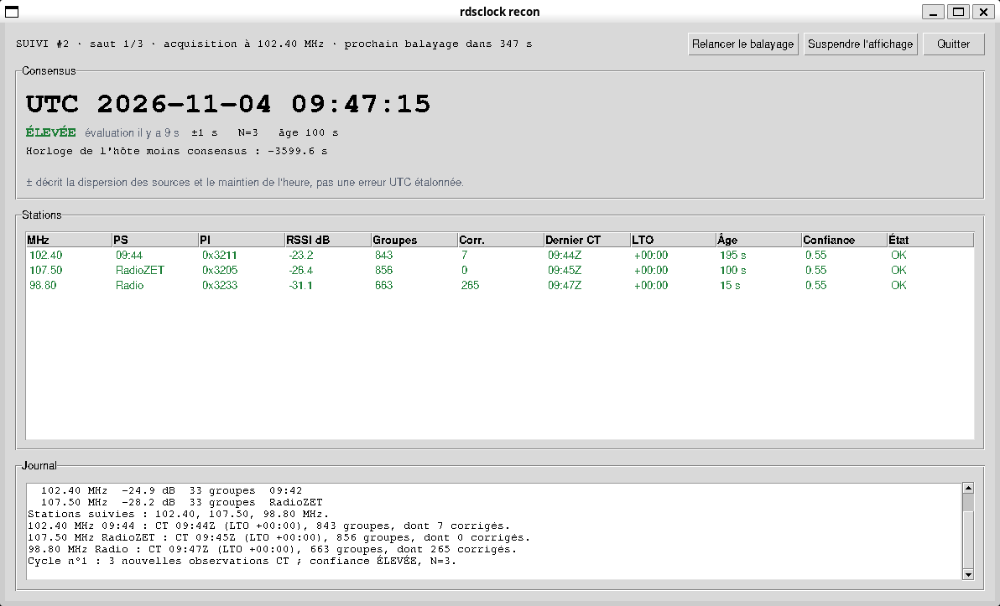
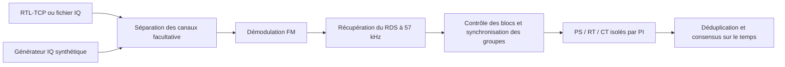

[English](README.md) · [Polski](README.pl.md) · [Français](README.fr.md)



# rdsclock — décodage RDS FM et comparaison des horloges

[](LICENSE)
[](pyproject.toml)
[](https://github.com/mateusz-klatt/rdsclock/actions/workflows/test.yml)
[](https://sonarcloud.io/summary/new_code?id=mateusz-klatt_rdsclock)
[](https://sonarcloud.io/component_measures?id=mateusz-klatt_rdsclock&metric=coverage)

**Décodez les métadonnées de la radiodiffusion FM, recevez plusieurs stations à
partir d'une seule acquisition SDR et comparez les heures qu'elles annoncent.**
`rdsclock` réalise la chaîne de traitement RDS en Python avec NumPy et SciPy,
des échantillons IQ jusqu'à l'identification des stations et aux données
Clock-Time (CT) du groupe 4A.

Ce démonstrateur technique permet d'étudier l'heure diffusée par radio lorsque
le GNSS ou le NTP est indisponible. Il prend en charge la réception RTL-SDR via
`rtl_tcp`, les fichiers IQ hors ligne, les signaux synthétiques et un consensus
sur l'heure avec détection des valeurs aberrantes et maintien autonome
(holdover). La réception ne nécessite aucune émission RF ; un récepteur distant
utilise toutefois une connexion réseau.

**Le décodage en réception réelle est validé ; l'exactitude absolue de l'heure
UTC ne l'est pas.** Les derniers essais sur antenne ont récupéré des messages CT
de trois services, dont les heures annoncées étaient en avance d'environ une
heure sur l'UTC de l'hôte. L'accord entre les sources et la validité des CRC ne
garantissent ni l'exactitude ni l'authenticité de l'heure.

[Scénario de démonstration](docs/demo.md) ·
[Démonstration matérielle sur toute la bande](docs/full-band-demo-2026-11-02.md) ·
[Architecture](docs/ARCHITECTURE.md) · [Modèle de menace](docs/THREAT_MODEL.md)

## Résultats démontrés

Mesures réalisées à Varsovie–Wilanów le **2 novembre 2026**, avec un seul RTL-SDR :

| Essai | Résultat observé |
|---|---|
| Balayage de la bande FM, 87,5–108 MHz | 206 points d'accord, 2 s par point ; 16 codes PI distincts confirmés |
| WIDE, une acquisition de 12 s | Eska ROCK 102,0, Jedynka 102,4 et Radio Kolor 103,0 MHz : 136, 136 et 137 groupes RDS |
| WIDE, une autre acquisition de 12 s | RMF Classic 98,3 et Trójka 98,8 MHz : 136 groupes chacune |
| HOP, 75 s par station | Jedynka / Trójka / Radio ZET : 829 / 643 / 846 groupes ; CT récupéré sur les trois |
| Validation logicielle | 329 tests réussis, 1 test facultatif sur un fichier IQ local ignoré, 3 tests matériels exclus de la sélection |

Les canaux WIDE partagent le même intervalle d'acquisition et sont décodés après
celle-ci. HOP reçoit les stations successivement. Aucun de ces modes ne reçoit
toute la bande FM simultanément avec une seule clé SDR. Le balayage a aussi
révélé des PI répétés à 1 MHz d'écart ; la cause reste indéterminée, et les points
d'accord ne sont donc pas comptés comme autant d'émetteurs distincts. L'absence
de CT dans une acquisition courte ne prouve pas qu'une station n'en diffuse
jamais.



La figure représente une succession de mesures, et non un spectre RF simultané
ou étalonné. Le [rapport complet](docs/full-band-demo-2026-11-02.md) présente les
paramètres, les spectres WIDE et les limites ; l'[étude du gain](docs/hardware-validation-2026-10-31.md)
fournit les comparaisons antérieures. Il s'agit de résultats observés, pas de
garanties de réception.

## Démarrage rapide — sans SDR

À partir du dépôt, avec **Python 3.12+** et **uv** installés :

```bash
git clone https://github.com/mateusz-klatt/rdsclock.git
cd rdsclock
uv sync --frozen --extra dev --extra plot --no-install-project --no-build
export PYTHONPATH="$PWD/src"

# Signaux connus à travers la chaîne complète de décodage multicanal.
.venv/bin/python -m rdsclock demo --time 2026-11-02T12:00:00+00:00 --seed 42

# Trois sources concordantes, un écart de dix minutes et un PI répété.
.venv/bin/python examples/consensus_demo.py
```

Le premier exemple doit récupérer le CT attendu pour chacune des trois stations
générées. Le second vérifie le consensus séparément : un PI répété n'ajoute
aucun vote et la valeur aberrante est identifiée. Les deux fonctionnent hors
ligne après l'installation des dépendances. Les commandes suivantes utilisent
le même terminal et le même environnement.

## Réception en direct

Utilisez un RTL-SDR avec une antenne FM et un accès exclusif à `rtl_tcp`. Sur la
machine à laquelle la clé est raccordée, lancez le serveur sur l'interface de
boucle locale :

```bash
rtl_tcp -a 127.0.0.1 -p 1234
```

Pour une clé distante, laissez un tunnel SSH ouvert dans un autre terminal ;
remplacez `SDR_HOST` par l'hôte du récepteur :

```bash
ssh -N -L 1234:127.0.0.1:1234 SDR_HOST
```

Dans les deux cas, le client se connecte ensuite à `127.0.0.1:1234`. RTL-TCP
n'intègre ni authentification ni chiffrement. Arrêtez les autres clients SDR
avant de vous connecter.

### Une station et son horloge

```bash
.venv/bin/python -m rdsclock live --host 127.0.0.1 \
  --freq 102.4 --duration 75 --gain 19.7 --settle-seconds 1 -v
```

Choisissez une fréquence recevable à votre emplacement. Cet exemple utilise un
canal testé à Varsovie ; une durée de 75 secondes laisse davantage de chances
de recevoir du CT qu'un balayage court, sans le garantir. Pour choisir le gain,
comparez les groupes sans correction et les groupes corrigés, le PI confirmé
et la proportion de composantes I/Q aux extrémités de la plage de conversion.
Un même gain n'est pas optimal pour toutes les stations ; consultez les
[comparaisons mesurées](docs/hardware-validation-2026-10-31.md).

### Plusieurs stations : WIDE et HOP

```bash
# Acquisition simultanée ; décodage de trois canaux à partir des mêmes échantillons IQ.
.venv/bin/python -m rdsclock multi --host 127.0.0.1 --mode wide \
  --freqs 102.0,102.4,103.0 --center 102.85 --fs 2400000 \
  --duration 12 --gain 28 --settle-seconds 1

# Accords successifs ; 75 secondes par station, plus stabilisation et décodage.
.venv/bin/python -m rdsclock multi --host 127.0.0.1 --mode hop \
  --freqs 102.4,98.8,107.5 --duration 75 --gain 19.7 --settle-seconds 1
```

En mode WIDE, tous les canaux doivent tenir dans la bande passante du récepteur,
avec les marges nécessaires aux filtres. À 2,4 Méch/s, un tableau `complex64` de
12 secondes occupe à lui seul environ 230 Mo ; le traitement nécessite de la
mémoire supplémentaire. Le décodage suit l'acquisition : il ne s'agit pas d'une
écoute audio continue de plusieurs stations. HOP permet de couvrir des fréquences
très éloignées les unes des autres.

`--settle-seconds` reçoit et écarte activement les échantillons avant chaque
acquisition complète. Cette option ne réduit pas `--duration`. Une purge limitée
dans le temps réduit le risque de conserver des échantillons en attente issus
de l'accord précédent, mais RTL-TCP ne fournit ni accusé de réception des
commandes d'accord ni horodatage matériel.

### Exploration de la bande et observation continue

```bash
# 206 points d'accord ; au moins 412 secondes d'échantillons, hors surcoûts.
.venv/bin/python -m rdsclock scan --host 127.0.0.1 \
  --start 87.5 --end 108.0 --step 0.1 --duration 2 --settle-seconds 0.3

# Balayer une plage réduite, établir une liste de suivi, puis répéter les observations.
.venv/bin/python -m rdsclock recon --host 127.0.0.1 \
  --start 98.0 --end 108.0 --step 0.1 --scan-dwell 2 --dwell 75 \
  --max-stations 3 --gain 19.7 --rssi-threshold -35 --settle-seconds 1 --iterations 3
```

Le balayage exploratoire court recherche du RDS décodable ; il peut manquer les
messages CT et les stations faibles. Adaptez le seuil de signal à votre antenne
et à votre récepteur ; `-35` est un point de départ pour inclure les canaux plus
faibles. `recon` classe les candidats, parcourt une liste de suivi et présente un
consensus avec maintien autonome entre les observations. Son balayage initial et ses acquisitions répétées prennent plus
de temps que les courtes démonstrations. Consultez le
[guide opérateur](docs/operator-quickstart.md) pour les détails.

### Tableaux de bord

`recon` peut afficher sa progression en direct dans un terminal, un navigateur
ou une fenêtre de bureau. Ajoutez l'une de ces options à la commande `recon`
ci-dessus et retirez `--iterations` pour que l'observation continue jusqu'à ce
que vous quittiez :

- `--tui` : un tableau de bord dans le terminal ; ajoutez d'abord
  `--extra tui` à `uv sync`.
- `--web` : une page à l'adresse <http://127.0.0.1:8080/>, sans dépendance
  supplémentaire ; `--web-port` change le port.
- `--gui` : une fenêtre de bureau, avec le module tkinter de Python.

```bash
uv sync --frozen --extra dev --extra plot --extra tui --no-install-project --no-build

.venv/bin/python -m rdsclock recon --host 127.0.0.1 \
  --start 98.0 --end 108.0 --step 0.1 --scan-dwell 2 --dwell 75 \
  --max-stations 3 --gain 19.7 --rssi-threshold -35 --settle-seconds 1 --tui
```

Chaque tableau de bord lance `recon --jsonl` comme processus enfant avec les
mêmes réglages du récepteur et affiche le consensus, les stations et un journal.
*Rescan* (`r`) demande un balayage d'acquisition après le cycle en cours et
*Pause view* (`p`) fige l'affichage pendant que la réception continue ; la page
propose les deux sous forme de boutons. `q` ferme le tableau de bord du
terminal et la fenêtre, et `Ctrl+C` arrête le tableau de bord web. La page n'a
pas d'authentification et n'écoute que sur l'interface de bouclage : pour
suivre un `recon` lancé sur une autre machine, redirigez le port avec
`ssh -N -L 8080:127.0.0.1:8080 SDR_HOST`. Le Python système de Debian ou Ubuntu
obtient tkinter avec `apt install python3-tk`. Avec `--jsonl`, `recon` écrit
plutôt un événement JSON par ligne pour d'autres programmes ; le
[guide opérateur](docs/operator-quickstart.md) décrit tous ces modes.

#### Langue du tableau de bord

Dans la version 2.0.0, les trois interfaces prennent en charge l'anglais, le
polonais et le français. Ajoutez `--lang en`, `--lang pl` ou `--lang fr` à la
commande avec `--tui`, `--web` ou `--gui` ; l'anglais est la langue par défaut.
Par exemple, pour ouvrir le tableau de bord web en polonais :

```bash
.venv/bin/python -m rdsclock recon --host 127.0.0.1 \
  --wide 98.3,98.8 --gain 28 --dwell 75 --web --lang pl
```

La langue choisie s'applique aux commandes, aux titres, aux messages d'état et
au journal opérateur. Les valeurs PS/PI/CT reçues et les noms des champs JSON
Lines restent inchangés. Chaque tableau de bord lance son propre processus de
réception ; utilisez une seule de ces commandes à la fois avec un même serveur
RTL-TCP. Les captures d'écran de réception réelle ci-dessous montrent
l'interface en français.

[Notes de version 2.0.0 — EN / PL / FR](docs/releases/2.0.0.md) ·
[Procédure de publication](docs/releasing.md)

#### WIDE : deux stations dans une même capture

Avec `--wide`, `recon` enregistre en une seule capture les stations qui tiennent
dans la bande du récepteur ; les tableaux de bord les montrent alors toutes
ensemble, sans sauter d'une station à l'autre. Ici, RMF Classic et PR Trójka,
qui diffusent toutes deux l'heure (CT), partagent chaque capture de 75 secondes
à 2,4 MS/s : elles donnent la même minute, et le consensus les combine (N=2,
confiance MOYENNE). Les captures proviennent de cette commande, avec `--web` ou
`--gui` à la place de `--tui` :

```bash
.venv/bin/python -m rdsclock recon --host 127.0.0.1 \
  --wide 98.3,98.8 --gain 28 --scan-dwell 3 --dwell 75 \
  --settle-seconds 1 --tui --lang fr
```

**Terminal** (`--tui`)



**Navigateur** (`--web`)



**Fenêtre de bureau** (`--gui`)



#### HOP : trois stations l'une après l'autre

Avec `--hop`, `recon` visite les stations indiquées, où qu'elles soient dans la
bande, une capture de 75 secondes après l'autre. Radio ZET, PR Jedynka et
PR Trójka donnent chacune une minute différente, et toutes trois concordent
(N=3). Le récepteur évalue la confiance une fois par cycle, et les tableaux de
bord conservent ce niveau jusqu'à l'évaluation suivante. ÉLEVÉE (HIGH) exige
trois stations confirmées dont l'âge médian du CT est inférieur à deux minutes à
ce moment ; MOYENNE (MEDIUM) en exige deux sous trois minutes. Un cycle de trois
captures de 75 secondes peut se terminer de part et d'autre de la limite de deux
minutes ; celui de ces captures s'est terminé au niveau ÉLEVÉE :

```bash
.venv/bin/python -m rdsclock recon --host 127.0.0.1 \
  --hop 98.8,102.4,107.5 --gain 19.7 --scan-dwell 3 --dwell 75 \
  --settle-seconds 1 --tui --lang fr
```

**Terminal** (`--tui`)



**Navigateur** (`--web`)



**Fenêtre de bureau** (`--gui`)



*Réception réelle à Varsovie le 4 novembre 2026. Les heures UTC reçues
étaient en avance d'environ une heure sur l'UTC de l'hôte. Il s'agit d'un écart
observé ; l'accord des sources n'en établit ni la cause ni l'exactitude absolue.*

## Fonctionnement



Le décodeur utilise le pilote stéréo à 19 kHz pour localiser la sous-porteuse RDS,
puis récupère les symboles biphases, valide les mots de contrôle des blocs et
extrait l'identification de programme (PI), le nom Programme Service (PS), le
RadioText (RT) et le Clock-Time. Les groupes sans correction et les groupes
corrigés sont comptabilisés séparément. Les données associées à des PI différents
restent séparées.

Le consensus utilise l'instant de réception estimé plutôt que l'instant de fin
du décodage, rejette les observations périmées et déduplique les canaux et les PI
confirmés. Une médiane et des contrôles des valeurs aberrantes permettent le
maintien autonome à partir de l'horloge monotone de l'hôte. `HIGH` indique un
accord selon ce modèle ; des PI distincts peuvent néanmoins partager une même
horloge amont erronée. L'incertitude annoncée décrit la dispersion des sources
et le maintien autonome, pas une borne étalonnée de l'erreur absolue sur l'UTC.
L'API expérimentale à résolution inférieure à la seconde présente la même
limitation.

Le [document d'architecture](docs/ARCHITECTURE.md) décrit les modules et
l'algorithme de consensus ; le [modèle de menace](docs/THREAT_MODEL.md) détaille
les hypothèses de confiance et les risques résiduels.

### Groupe 4A : champs temporels

L'heure et la minute UTC ainsi que le jour julien modifié (MJD) sont distincts
du décalage de l'heure locale (LTO). Les champs sont répartis dans les mots de
données comme suit :

| Champ | Bloc B | Bloc C | Bloc D |
|---|---|---|---|
| MJD, 17 bits | `[1:0]` (bits de poids fort) | `[15:1]` (bits de poids faible) | — |
| Heure, 5 bits | — | `[0]` (bit de poids fort) | `[15:12]` (bits de poids faible) |
| Minute, 6 bits | — | — | `[11:6]` |
| Signe / amplitude du LTO | — | — | `[5]` / `[4:0]` |

L'origine du MJD est le 1858-11-17 ; le LTO est exprimé en demi-heures. Les
valeurs reçues sont conservées même lorsqu'elles diffèrent de l'heure de l'hôte.
Consultez les [références normatives](docs/REFERENCES.md) et
[l'extraction indépendante des champs](docs/hardware-validation-2026-10-31.md#clock-time-decoding-succeeded-clock-agreement-did-not).

## API Python et fonctions facultatives

L'API publique prise en charge est exportée par `rdsclock`. Pour un fichier IQ
local enregistré à 250 kéch/s :

```python
from rdsclock import decode_file

result = decode_file("build/local.iq", fs=250_000)
pi = result.info.pi
print(f"PI: {pi:#06x}" if pi is not None else "PI not confirmed")
print(f"Groups: {result.n_groups}; clean: {result.n_groups_clean}")
for ct in result.clock_times:
    print(ct.utc, ct.rx_monotonic_ns)
```

Créez votre propre entrée avec `live --save build/local.iq` après
`mkdir -p build`, ou utilisez `generate build/local.iq --seed 42` avec
l'interface en ligne de commande ci-dessus. Faites correspondre `fs` à la
fréquence d'échantillonnage de l'acquisition. Un fichier sans référence temporelle
de réception ne permet pas de déterminer quand ses échantillons ont été reçus.

| Dépendances facultatives | Fonction |
|---|---|
| `audio` | Écoute audio FM d'une station via `sounddevice` |
| `plot` | Figures du spectre MPX et du spectrogramme via `matplotlib` |
| `fast` | Accélération facultative avec Numba |
| `tui` | Tableau de bord en terminal pour `recon --tui` via `textual` |
| `dev` | Tests, couverture, Ruff et Black |

Ajoutez le `--extra` correspondant à `uv sync`. Les exemples de réception de
plusieurs stations ne nécessitent pas l'extra audio. Utilisez
`.venv/bin/python -m rdsclock --help` pour consulter toutes les commandes.

## Vérification et documentation

```bash
# Tests logiciels, y compris les vérifications synthétiques lentes ; aucun récepteur requis.
.venv/bin/python -m pytest tests/ -m 'not real_sdr' -q -W error
.venv/bin/ruff check src/ tests/ examples/
.venv/bin/black --check src/ tests/ examples/
```

L'intégration continue utilise le fichier `uv.lock` versionné ; la sélection
rapide exclut également les tests marqués `slow`. Les essais synthétiques
vérifient le passage d'une entrée connue à travers le décodeur complet ; les
tests de transport couvrent les changements d'accord, les tampons et la
fermeture des connexions. Les tests de non-régression sur des fichiers IQ locaux
et les mesures sur antenne complètent ces vérifications. L'absence d'un
enregistrement facultatif entraîne un test ignoré, et non un test réussi.

- [Scénario de démonstration](docs/demo.md) — une courte présentation technique.
- [Démonstration sur toute la bande, 2026-11-02](docs/full-band-demo-2026-11-02.md) — balayage, WIDE, HOP et observations inexpliquées.
- [Validation du gain et du temps](docs/hardware-validation-2026-10-31.md) — mesures et interprétation.
- [Architecture](docs/ARCHITECTURE.md), [modèle de menace](docs/THREAT_MODEL.md) et [guide opérateur](docs/operator-quickstart.md).
- [Jeux de données](docs/datasets.md), [références](docs/REFERENCES.md), [journal des modifications](CHANGELOG.md) et [contribution](CONTRIBUTING.md).

Le projet est distribué sous [licence Apache 2.0](LICENSE). Conservez localement
les acquisitions IQ, l'audio et les textes diffusés ; les rapports matériels
contiennent des mesures agrégées et des figures. Les signaux synthétiques
permettent des démonstrations reproductibles sans partager d'enregistrements de
radiodiffusion. Consultez [SECURITY.md](SECURITY.md) pour les consignes de gestion
des données.
