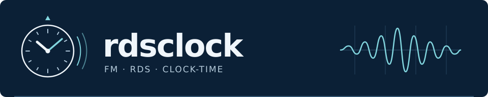
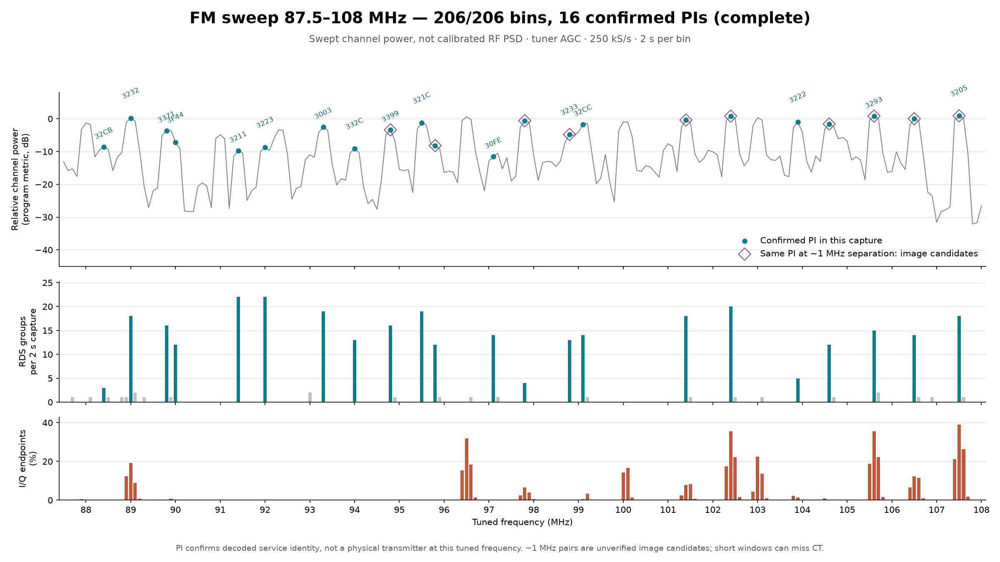
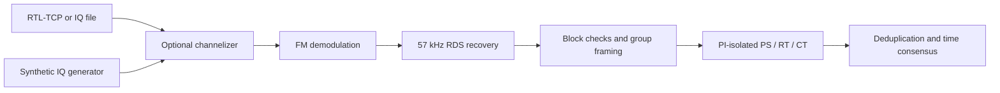

[English](README.md) · [Polski](README.pl.md) · [Français](README.fr.md)



# rdsclock — FM RDS decoding and clock comparison

[](LICENSE)
[](pyproject.toml)
[](https://github.com/mateusz-klatt/rdsclock/actions/workflows/test.yml)
[](https://sonarcloud.io/summary/new_code?id=mateusz-klatt_rdsclock)
[](https://sonarcloud.io/component_measures?id=mateusz-klatt_rdsclock&metric=coverage)

**Decode broadcast FM metadata, receive several stations from one SDR capture,
and compare their declared time.** `rdsclock` implements the RDS signal-processing
chain in Python with NumPy and SciPy, from IQ samples to station identity and
Group 4A Clock-Time (CT).

It is an engineering demonstrator for exploring broadcast time when GNSS or NTP
is unavailable. It supports RTL-SDR reception through `rtl_tcp`, offline IQ files,
synthetic signals and time consensus with outlier detection and holdover.
Reception requires no RF transmission; a remote receiver still uses a network
connection.

**Live decoding is validated; absolute UTC accuracy is not.** The latest antenna
tests recovered CT from three services, with declarations approximately one hour
ahead of host UTC. Source agreement and valid CRCs do not establish correct or
authenticated time.

[Demo walkthrough](docs/demo.md) ·
[Full-band hardware demo](docs/full-band-demo-2026-11-02.md) ·
[Architecture](docs/ARCHITECTURE.md) · [Threat model](docs/THREAT_MODEL.md)

## What has been demonstrated

Measurements from Warsaw–Wilanów on **2 November 2026**, using one RTL-SDR:

| Experiment | Observed result |
|---|---|
| FM band scan, 87.5–108 MHz | 206 tuning points, 2 s each; 16 distinct confirmed PI codes |
| WIDE, one 12 s capture | Eska ROCK 102.0, Jedynka 102.4 and Radio Kolor 103.0 MHz: 136, 136 and 137 RDS groups |
| WIDE, another 12 s capture | RMF Classic 98.3 and Trójka 98.8 MHz: 136 groups each |
| HOP, 75 s per station | Jedynka / Trójka / Radio ZET: 829 / 643 / 846 groups; CT recovered on all three |
| Software validation | 329 passed, 1 optional local-IQ test skipped, 3 hardware tests deselected |

WIDE channels share the same capture interval and are decoded after capture.
HOP receives stations sequentially. Neither mode receives the entire FM band
simultaneously with one dongle. The scan also found repeated PIs 1 MHz apart;
their cause remains unresolved, so tuning points are not counted as separate
transmitters. Short captures without CT do not establish that a station never
broadcasts it.



The figure is a sequence of measurements, not a simultaneous or calibrated RF
spectrum. See the [full report](docs/full-band-demo-2026-11-02.md) for parameters,
WIDE spectra and limitations, and the [gain study](docs/hardware-validation-2026-10-31.md)
for earlier comparisons. These are recorded outcomes, not reception guarantees.

## Quick start — no SDR required

From a checkout, with **Python 3.12+** and **uv** installed:

```bash
git clone https://github.com/mateusz-klatt/rdsclock.git
cd rdsclock
uv sync --frozen --extra dev --extra plot --no-install-project --no-build
export PYTHONPATH="$PWD/src"

# Known signals through the complete multi-channel decoder.
.venv/bin/python -m rdsclock demo --time 2026-11-02T12:00:00+00:00 --seed 42

# Three agreeing sources, a ten-minute outlier and a repeated PI.
.venv/bin/python examples/consensus_demo.py
```

The first example should recover the expected CT for all three generated
stations. The second exercises consensus separately: a repeated PI adds no vote,
and the outlier is identified. Both work offline after dependency installation.
The commands below use the same shell and environment.

## Live reception

Use an RTL-SDR with an FM antenna and exclusive access to `rtl_tcp`. On the
machine with the dongle, start the server on loopback:

```bash
rtl_tcp -a 127.0.0.1 -p 1234
```

For a remote dongle, leave an SSH tunnel running in another terminal; replace
`SDR_HOST` with your receiver host:

```bash
ssh -N -L 1234:127.0.0.1:1234 SDR_HOST
```

The client then connects to `127.0.0.1:1234` in either case. RTL-TCP has no
built-in authentication or encryption. Stop other SDR clients before connecting.

### One station and its clock

```bash
.venv/bin/python -m rdsclock live --host 127.0.0.1 \
  --freq 102.4 --duration 75 --gain 19.7 --settle-seconds 1 -v
```

Choose a locally receivable frequency. This example uses a tested Warsaw
channel; 75 seconds gives CT more opportunity to appear than a short scan,
but does not guarantee it. Compare clean/corrected groups, confirmed PI and
I/Q endpoint occupancy when choosing gain. One gain setting is not optimal
for every station; see the [measured comparisons](docs/hardware-validation-2026-10-31.md).

### Several stations: WIDE and HOP

```bash
# Simultaneous capture; decode three channels from the same IQ samples.
.venv/bin/python -m rdsclock multi --host 127.0.0.1 --mode wide \
  --freqs 102.0,102.4,103.0 --center 102.85 --fs 2400000 \
  --duration 12 --gain 28 --settle-seconds 1

# Sequential tuning; 75 seconds per station, plus settling and decoding.
.venv/bin/python -m rdsclock multi --host 127.0.0.1 --mode hop \
  --freqs 102.4,98.8,107.5 --duration 75 --gain 19.7 --settle-seconds 1
```

WIDE requires all channels to fit inside the receiver bandwidth with filter
margins. At 2.4 MS/s, a 12-second `complex64` array alone occupies about 230 MB;
processing needs additional memory. This is capture-then-decode, not continuous
multi-station audio playback. HOP can cover widely separated frequencies.

`--settle-seconds` actively receives and discards samples before each full
capture. It does not shorten `--duration`. A bounded drain reduces queued-sample
carryover, but RTL-TCP provides neither tuning acknowledgements nor hardware
timestamps.

### Band discovery and continuous observation

```bash
# 206 tuning points; at least 412 seconds of samples, plus overhead.
.venv/bin/python -m rdsclock scan --host 127.0.0.1 \
  --start 87.5 --end 108.0 --step 0.1 --duration 2 --settle-seconds 0.3

# Scan a smaller range, build a watchlist, then repeat observation cycles.
.venv/bin/python -m rdsclock recon --host 127.0.0.1 \
  --start 98.0 --end 108.0 --step 0.1 --scan-dwell 2 --dwell 75 \
  --max-stations 3 --gain 19.7 --rssi-threshold -35 --settle-seconds 1 --iterations 3
```

The short discovery scan looks for decodable RDS; it can miss CT and weak
stations. Adjust the signal threshold for your antenna and receiver; `-35`
is a starting point for including weaker channels. `recon` ranks candidates,
hops through a watchlist and reports a
consensus with holdover between observations. Its acquisition scan and repeated
captures take longer than the short demos. See the
[operator guide](docs/operator-quickstart.md) for details.

For a live terminal dashboard, add `--extra tui` to `uv sync` and `--tui` to the
`recon` command. It shows the consensus, the stations and a log; `q` quits, `r`
requests a new scan and `p` pauses the view. `--web` serves the same view to a
browser at <http://127.0.0.1:8080/> without extra dependencies; it has no
authentication, so reach a remote receiver through an SSH tunnel. `--gui` opens it in a
desktop window with Python's tkinter. With
`--jsonl`, `recon` instead writes one JSON event per line for other programs.

## How it works



The decoder uses the 19 kHz stereo pilot to locate the RDS subcarrier, then
recovers biphase symbols, validates block checkwords and parses station identity
(PI), Programme Service (PS), RadioText (RT) and Clock-Time. Clean and corrected
groups are reported separately. Payloads from different PIs remain isolated.

Consensus uses estimated receipt time rather than decoder completion time,
rejects stale observations and deduplicates channels and confirmed PIs. A median
and outlier checks support holdover on the host monotonic clock. `HIGH` denotes
agreement under this model; distinct PIs can still share an incorrect upstream
clock. Reported uncertainty describes source dispersion and holdover, not a
calibrated absolute UTC error bound. The experimental subsecond API has the
same limitation.

Module details and the consensus algorithm are in the
[architecture document](docs/ARCHITECTURE.md); trust assumptions and remaining
risks are in the [threat model](docs/THREAT_MODEL.md).

### Group 4A: time fields

The UTC hour/minute and Modified Julian Day (MJD) are separate from the local
time offset (LTO). The data-word layout is:

| Field | Block B | Block C | Block D |
|---|---|---|---|
| MJD, 17 bits | `[1:0]` (high bits) | `[15:1]` (low bits) | — |
| Hour, 5 bits | — | `[0]` (high bit) | `[15:12]` (low bits) |
| Minute, 6 bits | — | — | `[11:6]` |
| LTO sign / magnitude | — | — | `[5]` / `[4:0]` |

MJD starts at 1858-11-17; LTO uses half-hour units. Received declarations are
preserved even when they disagree with the host. See the
[standards references](docs/REFERENCES.md) and the
[independent field extraction](docs/hardware-validation-2026-10-31.md#clock-time-decoding-succeeded-clock-agreement-did-not).

## Python API and optional features

The supported public API is exported from `rdsclock`. For a local IQ file
recorded at 250 kS/s:

```python
from rdsclock import decode_file

result = decode_file("build/local.iq", fs=250_000)
pi = result.info.pi
print(f"PI: {pi:#06x}" if pi is not None else "PI not confirmed")
print(f"Groups: {result.n_groups}; clean: {result.n_groups_clean}")
for ct in result.clock_times:
    print(ct.utc, ct.rx_monotonic_ns)
```

Create your own input using `live --save build/local.iq` after `mkdir -p build`,
or use `generate build/local.iq --seed 42` with the CLI above. Match `fs` to the
capture sample rate. A file without a reception-time anchor cannot establish
when its samples were received.

| Optional extra | Purpose |
|---|---|
| `audio` | Single-station FM audio playback via `sounddevice` |
| `plot` | MPX spectrum and waterfall figures via `matplotlib` |
| `fast` | Optional Numba acceleration |
| `tui` | Terminal dashboard for `recon --tui` via `textual` |
| `dev` | Tests, coverage, Ruff and Black |

Add the relevant `--extra` to `uv sync`. The live multi-station examples do not
require the audio extra. Use `.venv/bin/python -m rdsclock --help` for all commands.

## Verification and documentation

```bash
# Software tests, including slow synthetic checks; no live receiver required.
.venv/bin/python -m pytest tests/ -m 'not real_sdr' -q -W error
.venv/bin/ruff check src/ tests/ examples/
.venv/bin/black --check src/ tests/ examples/
```

CI uses the checked-in `uv.lock`; the fast test selection additionally excludes
`slow`. Synthetic round trips check known input through the complete decoder;
transport tests exercise retuning, buffering and connection cleanup. Local IQ
regressions and antenna measurements complement those tests. A missing optional
recording is reported as a skip, not a pass.

- [Demo walkthrough](docs/demo.md) — a short engineering presentation.
- [Full-band demo, 2026-11-02](docs/full-band-demo-2026-11-02.md) — scan, WIDE, HOP and unresolved observations.
- [Gain and timing validation](docs/hardware-validation-2026-10-31.md) — measurements and interpretation.
- [Architecture](docs/ARCHITECTURE.md), [threat model](docs/THREAT_MODEL.md) and [operator guide](docs/operator-quickstart.md).
- [Datasets](docs/datasets.md), [references](docs/REFERENCES.md), [changelog](CHANGELOG.md) and [contributing](CONTRIBUTING.md).

The project uses the [Apache License 2.0](LICENSE). Keep captured IQ, audio and
broadcast text local; the hardware reports contain aggregate measurements and
figures. Synthetic signals support reproducible demonstrations without sharing
broadcast recordings. See [SECURITY.md](SECURITY.md) for handling guidance.
