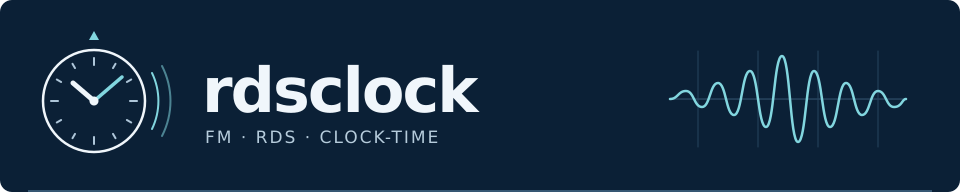
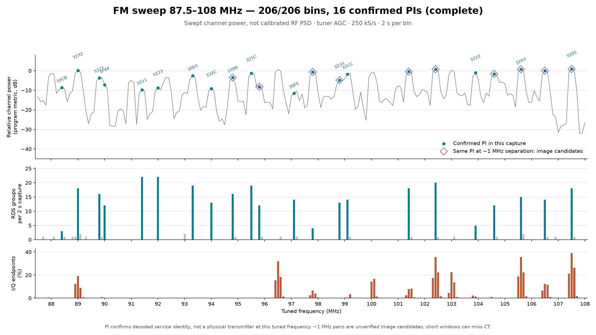
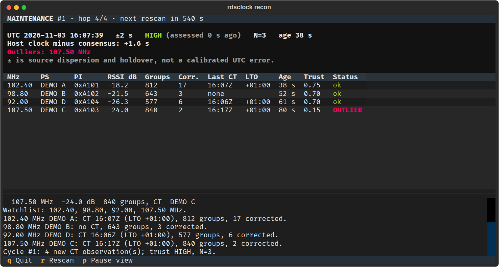
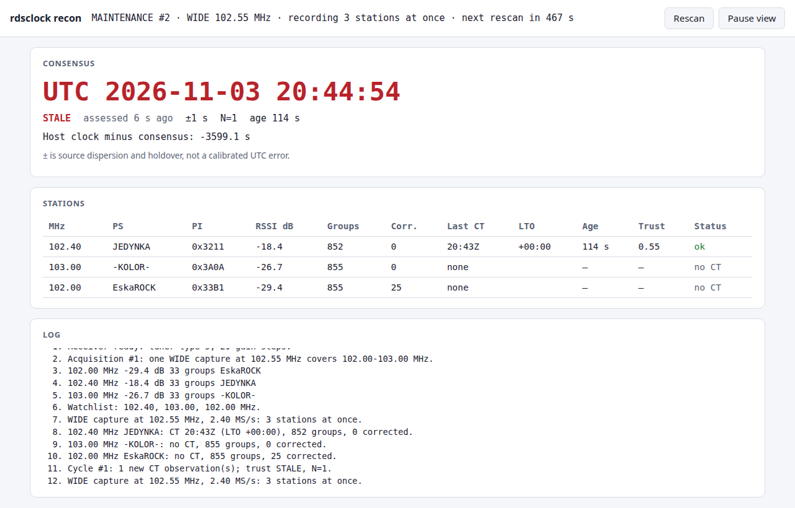
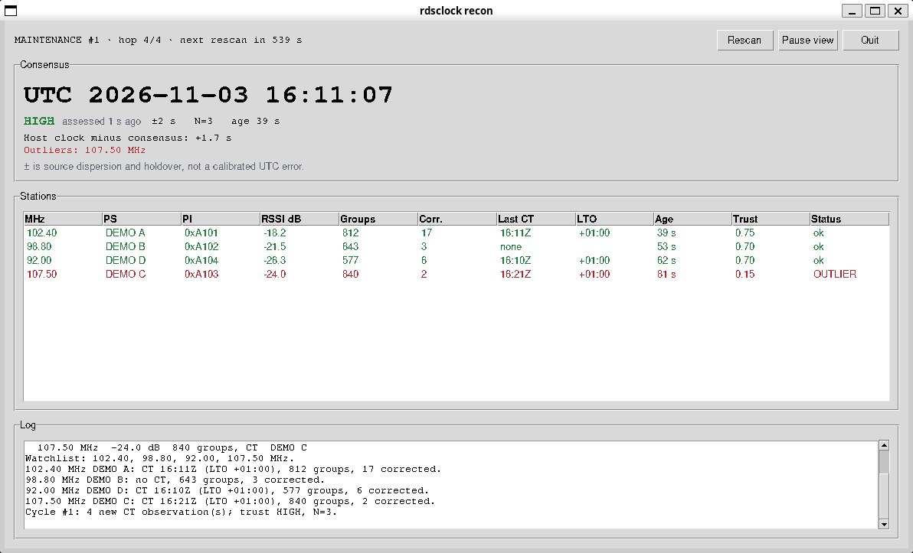
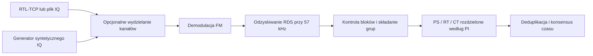

[English](README.md) · [Polski](README.pl.md) · [Français](README.fr.md)



# rdsclock — dekodowanie FM RDS i porównywanie zegarów

[](LICENSE)
[](pyproject.toml)
[](https://github.com/mateusz-klatt/rdsclock/actions/workflows/test.yml)
[](https://sonarcloud.io/summary/new_code?id=mateusz-klatt_rdsclock)
[](https://sonarcloud.io/component_measures?id=mateusz-klatt_rdsclock&metric=coverage)

**Dekoduj metadane rozgłośni FM, odbieraj kilka stacji z jednej rejestracji SDR
i porównuj deklarowany przez nie czas.** `rdsclock` implementuje w Pythonie,
z użyciem NumPy i SciPy, tor przetwarzania RDS: od próbek IQ do identyfikatora
stacji i danych Clock-Time (CT) z grupy 4A.

To demonstrator techniczny służący do badania czasu nadawanego przez rozgłośnie,
gdy GNSS lub NTP są niedostępne. Obsługuje odbiór przez RTL-SDR i `rtl_tcp`,
pliki IQ offline, sygnały syntetyczne oraz konsensus czasu z wykrywaniem wartości
odstających i podtrzymaniem oszacowania między obserwacjami (holdover).
Odbiór nie wymaga nadawania sygnału RF; zdalny odbiornik nadal wymaga połączenia
sieciowego.

**Dekodowanie na żywo zostało zweryfikowane; bezwzględna dokładność UTC — nie.**
Ostatnie pomiary antenowe pozwoliły odczytać CT z trzech programów radiowych,
z deklaracjami czasu wyprzedzającymi UTC hosta o około godzinę. Zgodność źródeł
i poprawne CRC nie potwierdzają ani prawidłowego czasu, ani jego autentyczności.

[Scenariusz demonstracji](docs/demo.md) ·
[Demo sprzętowe całego pasma](docs/full-band-demo-2026-11-02.md) ·
[Architektura](docs/ARCHITECTURE.md) · [Model zagrożeń](docs/THREAT_MODEL.md)

## Co potwierdzono w pomiarach

Pomiary wykonane w warszawskim Wilanowie **2 listopada 2026 r.**, z jednym RTL-SDR:

| Eksperyment | Zaobserwowany wynik |
|---|---|
| Skan pasma FM, 87,5–108 MHz | 206 punktów strojenia, po 2 s; 16 różnych potwierdzonych kodów PI |
| WIDE, jedna rejestracja 12 s | Eska ROCK 102,0, Jedynka 102,4 i Radio Kolor 103,0 MHz: 136, 136 i 137 grup RDS |
| WIDE, kolejna rejestracja 12 s | RMF Classic 98,3 i Trójka 98,8 MHz: po 136 grup |
| HOP, po 75 s na stację | Jedynka / Trójka / Radio ZET: 829 / 643 / 846 grup; CT odczytane ze wszystkich trzech |
| Walidacja oprogramowania | 329 testów zaliczonych, 1 opcjonalny test lokalnego IQ pominięty, 3 testy sprzętowe wyłączone z uruchomienia |

Kanały WIDE pochodzą z tego samego przedziału rejestracji i są dekodowane po jej
zakończeniu. HOP odbiera stacje kolejno. Żaden z tych trybów nie odbiera całego
pasma FM jednocześnie za pomocą jednego dongla. Skan wykazał też powtarzające
się PI w punktach oddalonych o 1 MHz; przyczyna pozostaje niewyjaśniona, dlatego
punktów strojenia nie liczymy jako osobnych nadajników. Brak CT w krótkiej
rejestracji nie dowodzi, że stacja nigdy go nie nadaje.



Wykres przedstawia serię pomiarów, a nie jednoczesne ani skalibrowane widmo RF.
[Pełny raport](docs/full-band-demo-2026-11-02.md) zawiera parametry, widma WIDE
i ograniczenia, a [badanie wzmocnienia](docs/hardware-validation-2026-10-31.md)
— wcześniejsze porównania. Są to wyniki konkretnych pomiarów, nie gwarancje odbioru.

## Szybki start — bez SDR

Wymagane są **Python 3.12+** i **uv**. Pobierz repozytorium i uruchom:

```bash
git clone https://github.com/mateusz-klatt/rdsclock.git
cd rdsclock
uv sync --frozen --extra dev --extra plot --no-install-project --no-build
export PYTHONPATH="$PWD/src"

# Znane sygnały przechodzą przez kompletny dekoder wielokanałowy.
.venv/bin/python -m rdsclock demo --time 2026-11-02T12:00:00+00:00 --seed 42

# Trzy zgodne źródła, odchylenie o dziesięć minut i powtórzony PI.
.venv/bin/python examples/consensus_demo.py
```

Pierwszy przykład powinien odczytać oczekiwany CT ze wszystkich trzech
wygenerowanych stacji. Drugi sprawdza sam konsensus: powtórzony PI nie dodaje
głosu, a wartość odstająca zostaje wskazana. Po zainstalowaniu zależności oba
przykłady działają offline. Dalsze polecenia korzystają z tej samej powłoki
i środowiska.

## Odbiór na żywo

Potrzebne są RTL-SDR z anteną FM oraz wyłączny dostęp do `rtl_tcp`. Na komputerze
z donglem uruchom serwer na interfejsie pętli zwrotnej:

```bash
rtl_tcp -a 127.0.0.1 -p 1234
```

Jeśli dongle jest zdalny, pozostaw tunel SSH uruchomiony w innym terminalu;
zastąp `SDR_HOST` adresem hosta odbiornika:

```bash
ssh -N -L 1234:127.0.0.1:1234 SDR_HOST
```

W obu przypadkach klient łączy się z `127.0.0.1:1234`. RTL-TCP nie ma wbudowanego
uwierzytelniania ani szyfrowania. Przed połączeniem zatrzymaj innych klientów SDR.

### Jedna stacja i jej zegar

```bash
.venv/bin/python -m rdsclock live --host 127.0.0.1 \
  --freq 102.4 --duration 75 --gain 19.7 --settle-seconds 1 -v
```

Wybierz częstotliwość odbieraną w swojej lokalizacji. Przykład używa sprawdzonego
kanału warszawskiego; 75 sekund daje większą szansę odebrania CT niż krótki skan,
ale tego nie gwarantuje. Dobierając wzmocnienie, porównuj grupy bez korekcji
i korygowane, potwierdzony PI oraz udział składowych I/Q na krańcach zakresu.
Jedno ustawienie wzmocnienia nie jest optymalne dla każdej stacji; zobacz
[porównania pomiarowe](docs/hardware-validation-2026-10-31.md).

### Kilka stacji: WIDE i HOP

```bash
# Jednoczesna rejestracja; trzy kanały dekodowane z tych samych próbek IQ.
.venv/bin/python -m rdsclock multi --host 127.0.0.1 --mode wide \
  --freqs 102.0,102.4,103.0 --center 102.85 --fs 2400000 \
  --duration 12 --gain 28 --settle-seconds 1

# Kolejne strojenia; po 75 sekund na stację, dodatkowo stabilizacja i dekodowanie.
.venv/bin/python -m rdsclock multi --host 127.0.0.1 --mode hop \
  --freqs 102.4,98.8,107.5 --duration 75 --gain 19.7 --settle-seconds 1
```

WIDE wymaga, aby wszystkie kanały mieściły się w paśmie odbiornika z zapasem
na filtry. Przy 2,4 MS/s sama tablica `complex64` dla 12 sekund zajmuje około
230 MB; przetwarzanie potrzebuje dodatkowej pamięci. Dane są najpierw
rejestrowane, a następnie dekodowane — nie jest to ciągłe odtwarzanie dźwięku
z wielu stacji. HOP może obejmować znacznie oddalone częstotliwości.

`--settle-seconds` określa czas aktywnego odbierania i odrzucania próbek przed
każdą pełną rejestracją. Nie skraca `--duration`. Opróżnianie buforów z limitem
czasu ogranicza przenoszenie starych próbek, ale RTL-TCP nie dostarcza
potwierdzeń strojenia ani sprzętowych znaczników czasu.

### Wyszukiwanie stacji i ciągła obserwacja

```bash
# 206 punktów strojenia; co najmniej 412 sekund próbek, plus czas obsługi.
.venv/bin/python -m rdsclock scan --host 127.0.0.1 \
  --start 87.5 --end 108.0 --step 0.1 --duration 2 --settle-seconds 0.3

# Skan mniejszego zakresu, wybór stacji, następnie kolejne cykle obserwacji.
.venv/bin/python -m rdsclock recon --host 127.0.0.1 \
  --start 98.0 --end 108.0 --step 0.1 --scan-dwell 2 --dwell 75 \
  --max-stations 3 --gain 19.7 --rssi-threshold -35 --settle-seconds 1 --iterations 3
```

Krótki skan szuka sygnału RDS, który da się zdekodować; może pominąć CT i słabe
stacje. Dopasuj próg sygnału do anteny i odbiornika; `-35` to punkt wyjścia
pozwalający uwzględnić słabsze kanały. `recon` ocenia kandydatów, przełącza się
między wybranymi stacjami
i podaje konsensus, podtrzymując oszacowanie czasu między obserwacjami.
Skan wstępny i powtarzane rejestracje trwają dłużej niż krótkie demonstracje.
Szczegóły opisuje [przewodnik operatora](docs/operator-quickstart.md).

### Panele podglądu

Postęp `recon` można śledzić na żywo w terminalu, w przeglądarce albo w oknie
aplikacji. Dodaj jedną z tych opcji do polecenia `recon` powyżej i pomiń
`--iterations`, aby obserwacja trwała do zamknięcia panelu:

- `--tui`: panel w terminalu; najpierw dodaj `--extra tui` do `uv sync`.
- `--web`: strona pod adresem <http://127.0.0.1:8080/>, bez dodatkowych
  zależności; `--web-port` zmienia port.
- `--gui`: okno aplikacji korzystające z modułu tkinter Pythona.

```bash
uv sync --frozen --extra dev --extra plot --extra tui --no-install-project --no-build

.venv/bin/python -m rdsclock recon --host 127.0.0.1 \
  --start 98.0 --end 108.0 --step 0.1 --scan-dwell 2 --dwell 75 \
  --max-stations 3 --gain 19.7 --rssi-threshold -35 --settle-seconds 1 --tui
```

Każdy panel uruchamia `recon --jsonl` jako proces potomny z tymi samymi
ustawieniami odbiornika i pokazuje konsensus, stacje oraz dziennik zdarzeń.
*Rescan* (`r`) zleca skan akwizycyjny po bieżącym cyklu, a *Pause view* (`p`)
wstrzymuje widok, podczas gdy odbiór trwa dalej; strona ma oba polecenia jako
przyciski. `q` zamyka panel w terminalu i okno, a `Ctrl+C` zatrzymuje panel w
przeglądarce. Strona nie ma uwierzytelniania i nasłuchuje tylko na interfejsie
loopback, więc aby śledzić `recon` działający na innym komputerze, przekieruj
port: `ssh -N -L 8080:127.0.0.1:8080 SDR_HOST`. Systemowy Python w Debianie
lub Ubuntu dostaje tkinter z pakietu `python3-tk`. Z opcją `--jsonl` polecenie
`recon` wypisuje zamiast tego po jednym zdarzeniu JSON w wierszu, na potrzeby
innych programów; wszystkie tryby opisuje
[przewodnik operatora](docs/operator-quickstart.md).

Z opcją `--wide` polecenie `recon` nagrywa stacje mieszczące się w paśmie
odbiornika w jednym przechwyceniu, więc panele pokazują je wszystkie naraz, bez
przeskakiwania między stacjami. Zrzuty poniżej to odbiór na żywo w Warszawie
3 listopada 2026: Eska ROCK, Jedynka i Radio Kolor dekodowane razem
z 75-sekundowych przechwyceń przy 2,4 MS/s. Panele uruchomiono tym poleceniem,
z `--web` lub `--gui` zamiast `--tui`:

```bash
.venv/bin/python -m rdsclock recon --host 127.0.0.1 \
  --wide 102.0,102.4,103.0 --gain 28 --scan-dwell 3 --dwell 75 \
  --settle-seconds 1 --tui
```

**Terminal** (`--tui`)



**Przeglądarka** (`--web`)



**Okno aplikacji** (`--gui`)



*Odbiór na żywo w Warszawie 3 listopada 2026. Z tych trzech stacji czas (CT) nadaje tylko Jedynka, więc konsensus opiera się na jednym źródle (N=1, zaufanie LOW lub STALE). Jedynka podaje w polu UTC polski czas lokalny, dlatego konsensus wyprzedza zegar hosta o godzinę.*

## Jak to działa



Dekoder wykorzystuje pilota stereo 19 kHz do znalezienia podnośnej RDS,
następnie odzyskuje symbole biphase, weryfikuje słowa kontrolne bloków
i odczytuje identyfikator stacji (PI), Programme Service (PS), RadioText (RT)
oraz Clock-Time. Grupy bez korekcji i korygowane są raportowane osobno.
Dane różnych PI pozostają rozdzielone.

Konsensus używa oszacowanego czasu odbioru zamiast czasu zakończenia dekodowania,
odrzuca nieaktualne obserwacje i deduplikuje kanały oraz potwierdzone PI.
Mediana i wykrywanie wartości odstających wspierają podtrzymanie oszacowania
na zegarze monotonicznym hosta. `HIGH` oznacza zgodność w ramach tego modelu;
różne PI nadal mogą korzystać z tego samego błędnego zegara źródłowego.
Raportowana niepewność opisuje rozrzut źródeł i podtrzymanie oszacowania,
a nie skalibrowaną granicę bezwzględnego błędu UTC. Eksperymentalne API
podsekundowe ma to samo ograniczenie.

Szczegóły modułów i algorytm konsensusu opisuje
[dokument architektury](docs/ARCHITECTURE.md), a założenia dotyczące zaufania
i pozostałe ryzyka — [model zagrożeń](docs/THREAT_MODEL.md).

### Grupa 4A: pola czasu

Godzina/minuta UTC i zmodyfikowana data juliańska (MJD) są oddzielone od
przesunięcia czasu lokalnego (LTO). Układ słów danych:

| Pole | Blok B | Blok C | Blok D |
|---|---|---|---|
| MJD, 17 bitów | `[1:0]` (starsze bity) | `[15:1]` (młodsze bity) | — |
| Godzina, 5 bitów | — | `[0]` (starszy bit) | `[15:12]` (młodsze bity) |
| Minuta, 6 bitów | — | — | `[11:6]` |
| Znak / wartość bezwzględna LTO | — | — | `[5]` / `[4:0]` |

MJD zaczyna się od 1858-11-17; jednostką LTO jest pół godziny. Odebrane
deklaracje są zachowywane również wtedy, gdy nie zgadzają się z czasem hosta.
Zobacz [odnośniki do standardów](docs/REFERENCES.md) oraz
[niezależny odczyt pól](docs/hardware-validation-2026-10-31.md#clock-time-decoding-succeeded-clock-agreement-did-not).

## API Pythona i funkcje opcjonalne

Obsługiwane publiczne API jest eksportowane z `rdsclock`. Przykład dla lokalnego
pliku IQ zarejestrowanego z częstotliwością próbkowania 250 kS/s:

```python
from rdsclock import decode_file

result = decode_file("build/local.iq", fs=250_000)
pi = result.info.pi
print(f"PI: {pi:#06x}" if pi is not None else "PI not confirmed")
print(f"Groups: {result.n_groups}; clean: {result.n_groups_clean}")
for ct in result.clock_times:
    print(ct.utc, ct.rx_monotonic_ns)
```

Przygotuj własne dane poleceniem `live --save build/local.iq` po wykonaniu
`mkdir -p build` albo użyj `generate build/local.iq --seed 42` z opisanym wyżej
CLI. Dopasuj `fs` do częstotliwości próbkowania rejestracji. Plik bez odniesienia
do czasu odbioru nie pozwala ustalić, kiedy odebrano jego próbki.

| Opcjonalny zestaw zależności | Zastosowanie |
|---|---|
| `audio` | Odtwarzanie dźwięku FM z jednej stacji przez `sounddevice` |
| `plot` | Wykresy widma MPX i wodospadu przez `matplotlib` |
| `fast` | Opcjonalne przyspieszenie przez Numba |
| `tui` | Panel terminalowy `recon --tui` przez `textual` |
| `dev` | Testy, pokrycie kodu, Ruff i Black |

Dodaj odpowiedni `--extra` do `uv sync`. Przykłady odbioru wielu stacji na żywo
nie wymagają dodatku audio. Listę wszystkich poleceń wyświetla
`.venv/bin/python -m rdsclock --help`.

## Weryfikacja i dokumentacja

```bash
# Testy oprogramowania, także wolniejsze testy syntetyczne; odbiornik niepotrzebny.
.venv/bin/python -m pytest tests/ -m 'not real_sdr' -q -W error
.venv/bin/ruff check src/ tests/ examples/
.venv/bin/black --check src/ tests/ examples/
```

CI używa pliku `uv.lock` z repozytorium; szybki zestaw testów dodatkowo pomija
znacznik `slow`. Testy syntetyczne sprawdzają znane dane wejściowe w pełnym torze
dekodera, a testy transportu — przestrajanie, buforowanie i zamykanie połączeń.
Uzupełniają je testy regresji na lokalnym IQ i pomiary antenowe. Brak opcjonalnego
nagrania jest raportowany jako pominięcie testu, nie jego zaliczenie.

- [Scenariusz demonstracji](docs/demo.md) — krótka prezentacja techniczna.
- [Demo całego pasma, 2026-11-02](docs/full-band-demo-2026-11-02.md) — skan, WIDE, HOP i niewyjaśnione obserwacje.
- [Walidacja wzmocnienia i czasu](docs/hardware-validation-2026-10-31.md) — pomiary i interpretacja.
- [Architektura](docs/ARCHITECTURE.md), [model zagrożeń](docs/THREAT_MODEL.md) i [przewodnik operatora](docs/operator-quickstart.md).
- [Zbiory danych](docs/datasets.md), [źródła](docs/REFERENCES.md), [historia zmian](CHANGELOG.md) i [zasady współpracy](CONTRIBUTING.md).

Projekt korzysta z [licencji Apache 2.0](LICENSE). Przechwycone IQ, dźwięk i tekst
rozgłośni przechowuj lokalnie; raporty sprzętowe zawierają zagregowane pomiary
i wykresy. Sygnały syntetyczne pozwalają przygotować powtarzalne demonstracje bez
udostępniania nagrań audycji. Wskazówki dotyczące postępowania z danymi znajdują
się w [SECURITY.md](SECURITY.md).
