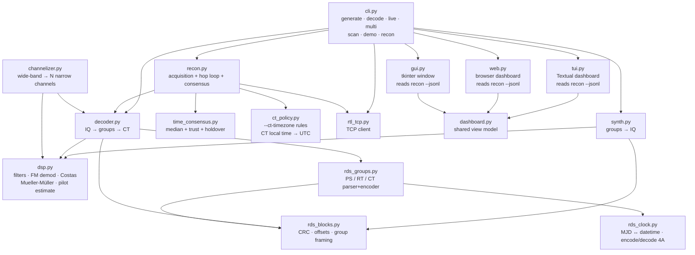
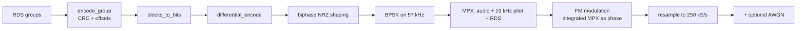

# Architecture

`rdsclock` is split into small, independently testable modules. Every
module is pure Python (NumPy + SciPy only) and side-effect free except
the obvious I/O entry points (`rtl_tcp.RtlTcpClient`, CLI helpers).

## Module Map

## Decoding Pipeline

The end-to-end pipeline `decode_iq(iq, fs)` runs the following stages,
each implemented in `dsp.py` and orchestrated by `decoder.py`:

1. **Channel filter** — FIR lowpass at ±100 kHz centred on the tuner.
2. **FM demodulation** — instantaneous-phase differentiation.
3. **Pilot-based carrier estimate** — locate the 19 kHz pilot (the
   `make_mpx` stereo reference) and multiply by 3 to get the RDS
   subcarrier centre. This is robust against typical RTL-SDR drift.
4. **Shift + filter** — bandpass around the located subcarrier, mix
   to DC, lowpass to ~4 kHz.
5. **Decimation** — drop to 19 kS/s (16 samples per symbol).
6. **Coarse frequency correction** — remove the residual offset
   via the phase-difference estimator.
7. **Symbol LPF** — zero-phase `filtfilt` at 4 kHz cut-off (falls
   back to `lfilter` for short streams).
8. **Costas loop** — second-order BPSK phase tracker.
9. **Clock recovery** — the biphase matched-filter output is sampled at
   each of the 16 symbol offsets, and the offset that yields the most groups
   wins. Long streams choose a fresh offset every 4096 bits (about 3.4 s):
   a station's bit clock can run tens of ppm away from the receiver's sample
   clock, and one offset for a 75-second capture slips by whole bits. Streams
   too short for the sweep fall back to best-symbol-offset (energy
   maximisation) raced against Mueller–Müller.
10. **Hard slice + differential decode** — recover data bits.
11. **Block hunt** — `find_groups_in_bitstream` slides over the
    bitstream looking for four consecutive valid blocks; enforces
    `C` vs `C'` offset based on the version bit in block B.
12. **Group parse** — `parse_groups` aggregates PS, RT and CT into
    a `StationInfo`.

## Synthesis Pipeline

`synth.py` is the inverse, used by the test suite to validate the
decoder end-to-end without an SDR:

## Multi-source Time Consensus

`time_consensus.TimeConsensus` keeps a per-station track
(`StationTrack`) keyed by `(rounded_freq, PI)`. For each consensus
call:

1. Active tracks with nonnegative ages younger than `stale_age_s` are listed.
   One latest observation per channel and one per confirmed PI are selected;
   all tracks remain available for diagnostics. Unconfirmed PIs cannot raise
   trust above LOW by themselves. Distinct PIs do not prove independent clocks.
2. Each track produces an "estimated UTC right now" using its last
   observation plus elapsed monotonic time from its RX timestamp when present.
3. The median epoch and the MAD (median absolute deviation) are
   computed.
4. Tracks whose estimate diverges by more than
   `OUTLIER_THRESHOLD_S` from the median are penalised
   (`consecutive_outliers` ↑, `trust_score` ↓); the rest accumulate
   trust.
5. The uncertainty is `max(MAD/2, drift_term, 1 s)` where the drift
   term grows linearly with the age of the median.
6. The trust level (HIGH / MEDIUM / LOW / STALE) is derived from
   the number of contributing sources and the median age.

This uncertainty describes model dispersion and holdover, not a calibrated
absolute error bound. Multiple agreeing services can share the wrong clock.

`StationInfo` maintains separate payload state for each observed PI. Its public
PS/RT/CT and `group_counts` describe only the selected leading PI, while
`DecodeResult.n_groups` counts all valid groups across the capture. Those totals
can differ when multiple PIs are present; source identity takes precedence over
combining payloads.

Live clients apply explicit FM settings and use `capture_fresh` after a retune.
It actively discards data while settling, then requires a brief empty client
socket within a deadline. Errors close the connection, including partial IQ
pairs. RTL-TCP has no tune acknowledgement or hardware timestamps, so remote
queue freshness and physical reception time remain estimates; PI checks are
an additional independent attribution check.

An empty socket does not prove that the stream has caught up. While a client
decodes instead of reading, rtl_tcp queues the samples (up to 500 transfers of
256 KiB, about 27 s at 2.4 MS/s) and then sends them faster than real time, and
the quiet interval can end between two bursts of that backlog. `recon --wide`
decodes for about 45 s after every capture, so each of its cycles is exposed.
The capture start is therefore dated by sample arrival. Samples are produced at
the sample rate, so once `k` of them have arrived at host time `t`, the first
existed by `t − k / fs`. `capture_start_monotonic_ns` is the earliest of these
bounds over all reads of the capture, or the read start if that is earlier, and
`FreshCapture.queued_s` is how far before the read start it lies. Up to one
transfer is normal, because rtl_tcp sends each transfer once its last sample
exists (55 ms at 2.4 MS/s, 0.52 s at 250 kS/s); `backlogged` marks a capture
that started more than two transfers, and at least 0.25 s, behind.

The earliest bound dates the first sample only once the stream has caught up
with real time. A backlog longer than the capture arrives ahead of real time
throughout, and the samples are then older than the bound by an unknown amount.
Any capture that began more than one transfer and 50 ms behind must therefore
show that it caught up, whether or not that counts as `backlogged`. The end of
its read is divided into four segments of two transfers each, but at least a
sixth of a second each (0.67 s in all at 2.4 MS/s, 4.2 s at 250 kS/s). In real
time every transfer brings the bound back to the same level. So each segment
must contain reads, the lowest bounds of the segments must lie within 50 ms of
each other, and all of them must lie within the backlog threshold of the
earliest bound. Each of these conditions fails for a different cause:
- delivery 10 % or more ahead of real time lowers the bound from segment to
  segment, also after a stall;
- a stall leaves a segment without reads;
- a queue that stays keeps the level late.

Otherwise `caught_up` is false, and recon reports the capture's Clock-Time
without adding it to the consensus. No client can tell a fresh capture from
one whose queue stays within one transfer and 50 ms, or from one over a link
barely faster than the stream.

Dating the first sample at the capture end minus its duration gives the same
start when samples queue only before the capture, but samples lost during the
capture would move that start later for every sample. A loss only loosens the
bounds after it, so the earliest bound stays right for the samples before the
loss, and later samples are early by the lost time, as with the read start.
`capture_end_monotonic_ns − capture_start_monotonic_ns − len(iq) / fs` measures
that lost time, beyond up to one transfer. Draining until the stream rate falls
to real time would need a window of several transfers before every capture,
seconds at 250 kS/s, and many seconds per WIDE cycle on a link only a few times
faster than the stream; the receiver keeps the queued samples and dates them
instead. Dating keeps receive times consistent with the samples but does not
make them fresh: after a retune, a backlog can begin with the previous tuning,
which only the PI checks can catch. The bounds also assume that every sample
was produced at the current rate, so a capture must not begin with samples
queued before a sample-rate change.

## Recon Loop

`recon.run_recon` cycles through two phases:

- **Acquisition** when the watchlist is empty or `rescan_min`
  minutes have elapsed: `quick_scan_band` records short captures,
  attempts a decode, and ranks candidates by `(has_ct, n_groups,
  rssi_db)`. The top `max_watchlist` enter the watchlist. With
  `hop_freqs_hz` (CLI `--hop`) only the listed stations are checked, the RSSI
  threshold does not apply, and every one with RDS enters the watchlist.
- **Maintenance**: `hop_collect_ct` hops through the watchlist,
  recording `dwell_s` seconds per station and feeding decoded CT
  into the consensus engine. After every cycle the operator-facing
  status block is rendered (see `render_status`).
- **WIDE** (`ReconConfig.wide_freqs_hz`, CLI `--wide`): stations that fit in
  one capture are recorded together in both phases. An acquisition is one
  `scan_dwell_s` capture around `wide_center()`, a maintenance cycle one
  `dwell_s` capture. `channelizer.decode_channels` extracts and decodes every
  station from it, one at a time: each extraction mixes the station to DC block
  by block and decimates with one centred polyphase filter, so it holds a
  single complex64 copy of the capture, and channel sample times count from
  the capture start. All stations see the same minute edge, and a cycle lasts
  one dwell instead of one per station. The watchlist keeps every station with
  RDS, not only those with CT, because the capture contains them all anyway.

Every operator message also has a typed counterpart, delivered through
`on_event`: `recon_started`, `acquisition_started`, one `scan_step` per
tuning point (including points below the RSSI threshold),
`watchlist_updated`, `maintenance_started`, one `hop_result` per station,
`cycle_completed` and `recon_stopped`, plus `receiver_failed` when one of
several receivers fails. In WIDE mode `acquisition_started` and
`maintenance_started` also carry the capture centre and sample rate, and every
station of a capture produces a `hop_result`. Each `hop_result` carries the
`queued_s` of its capture, which its receive times already include, and
`caught_up`; verbose output names every backlogged capture. Its `clock_time`
keeps the broadcast `utc` and `local_offset_minutes` and adds the reading of
`ct_policy.CTPolicy` (CLI `--ct-timezone`): `ct_timezone`, `ct_status`
(`standard`, `converted`, `ambiguous` or `nonexistent`) and `effective_utc`,
the UTC the consensus would receive, `null` when the local time maps to no
single instant (`ambiguous`, `nonexistent`). A capture that did not catch up
(`caught_up` false) keeps its `effective_utc` but is not recorded either.
`recon_started` lists the rules as `ct_timezone_rules`. `cycle_completed`
carries the data behind the status block: the consensus result, the watchlist
and one row per track. The loop evaluates the consensus once per cycle and
passes the result to both outputs, because every evaluation updates trust
scores.
`rdsclock recon --jsonl` renders the events with `event_to_json`, one JSON
object per line on stdout, and moves the operator text to stderr. Before each
iteration the loop polls `rescan_requested`; the CLI sets it from `SIGUSR1`,
so a running receiver can be asked for a new acquisition scan.

### Several receivers

`ReconConfig.hop_stations` (CLI `--hop` items `HOST:PORT@MHZ`, IPv6 as
`[::1]:PORT@MHZ`) assigns each listed station to an `rtl_tcp` receiver;
items without one go to `host`/`port`. `hop_receivers()` groups the stations
by receiver. With one receiver `run_recon` runs the loop above unchanged; with
several, `_MultiReceiverRun` runs it with one `_ReceiverSlot` per receiver,
each holding its client, its stations and its part of the watchlist.

Each phase starts one thread per receiver and ends when all of them have
joined: connecting, the listed-station acquisition and the maintenance hops all
run in parallel, so a cycle lasts as long as the slowest receiver rather than
the sum of all dwells. With one station per receiver, each can listen a full
minute or more for the once-a-minute Clock-Time without lengthening the cycle.
Only the main thread decides the phases, evaluates the consensus and writes
`watchlist_updated` and `cycle_completed`.

The threads share one `TimeConsensus` and one output stream through
`_SharedOutputs`, whose re-entrant lock serialises every status line, progress
line and event, so JSON Lines records stay whole. `hop_collect_ct` takes the
same lock while a result enters the consensus and is reported, but not while it
records or decodes, so captures overlap. Progress lines name their receiver
(`[host:port] …`). An exception from an output callback in a worker is wrapped
as `_OutputError`, so that a failed write is re-raised after the join instead
of being mistaken for a failed receiver. After the run stops, the shared
outputs drop late output, so nothing follows `recon_stopped`.

A receiver whose connection or capture raises `OSError` is closed, its stations
leave the watchlist, and `receiver_failed` (`iteration`, `receiver`, `error`)
is written; the others go on. At the start of the next cycle the main thread
connects to it again; when that works, an acquisition checks its stations
before it rejoins the hops. No event marks the reconnection: the next
`scan_step`, `watchlist_updated` or `hop_result` that names the receiver shows
it. When every receiver has failed, the run ends with the latest error, as with
one receiver.

In JSON Lines, `recon_started` lists every receiver as `receivers`
(`host:port`), and each `hop_result`, watchlist entry and `scan_step` candidate
carries its `receiver`. A single-receiver run names its receiver too; readers
that ignore unknown keys need no change. The consensus itself does not know
about receivers: tracks follow the transmitter (PI and tuning), so two
receivers that hear the same station feed the same track. Receivers are not
independent sources: a broadcaster's wrong clock reaches every receiver alike.

`tools/replay_rtl_tcp.py` serves a recorded IQ file as an `rtl_tcp` server, so
multi-receiver runs and the dashboards can be tested next to a real receiver
or without one. It replays an old broadcast: its Clock-Time is as old as the
recording, so the consensus treats it as an outlier next to live stations.

The offline variant `run_recon_offline` replays the same logic over
pre-recorded `.iq` files and is the primary integration test for the
consensus engine.

## Terminal Dashboard

`tui.py` (optional extra `tui`) is the Textual application behind
`rdsclock recon --tui`. It starts `rdsclock recon --jsonl` as a child process
and only reads that stream. The receiver connection and the CPU-heavy decoding
stay in the child, so neither a long capture nor a pure-Python DSP loop can
stall the interface, and `SIGINT` stops the child without waiting for a capture
to finish. The dashboard sends `SIGUSR1` for a rescan, also when it receives one
itself; on quit it sends `SIGINT` and kills the child if it has not exited after
a timeout.

`dashboard.py` holds what every front end shows, without any UI code.
`DashboardState` type-checks each record before changing state and ignores
unknown events; `view()` returns display strings that `tui.py` only lays out
and styles. Between cycles the state advances the consensus time and ages with
its own monotonic clock and compares the current host clock with the advanced
consensus. It says when the receiver last assessed the trust level, and shows
the estimate as expired once its median CT age passes the consensus freshness
limit (`STALE_AGE_S`). Rows are keyed by exact tuning, the latest CT of a tuning
survives hops without CT until another confirmed PI answers there, and an
unconfirmed hop PI is shown as unknown rather than borrowed from the scan.
With several receivers, rows are keyed by receiver and tuning, since two
receivers may hear different transmitters on one frequency; `columns()` then
leads with a *Receiver* column, the hop status names what every receiver is
recording, and the log reports `receiver_failed` and the first event that
shows a failed receiver working again. With one receiver nothing changes.
Strings from broadcasts or the child process are reduced to printable
characters and rendered as plain text, never as Rich markup.
A station whose CT was read as local time shows its effective UTC with the
source zone, a CT that was not used says so, and a standard CT looks as it did
before 2.1.0. Without `--ct-timezone` rules, the log suggests the option once
per change when the consensus differs from the host clock by close to a whole
number of hours; the host clock is only a hint and nothing is adjusted.

## Browser Dashboard

`web.py` serves `rdsclock recon --web` with the standard library only: a
`ThreadingHTTPServer` and the static page in `webui/`. A `ReceiverProcess`
reads the `recon --jsonl` child on background threads and applies every line to
one `DashboardState` under a condition variable. Each browser keeps a
Server-Sent Events stream open (`/events`). It receives the current `view()`
after every change and at least once a second, so the page clock advances
between cycles. `/api/state` returns the same snapshot.

Any page that the operator opens in the browser can send requests to a loopback
server, so the server checks every request:

- `Host` must be `localhost`, an IP address or the configured host name; other
  names are refused with 421, which defeats DNS rebinding.
- `POST /api/rescan` needs an `X-Requested-By` header. That header forces a CORS
  preflight, which the server never grants to another site. It also needs a
  same-origin `Origin` when one is sent, and a loopback client.
- Responses carry a Content-Security-Policy that allows only same-origin scripts
  and styles and no framing. The page inserts every value with `textContent`.

The server binds to 127.0.0.1 unless `--web-host` names another address, and
then warns that the page has no authentication.

## Desktop Window

`gui.py` is the tkinter window behind `rdsclock recon --gui`; it needs no
dependency beyond Python's own Tk support. A `ReceiverProcess` reads the
`recon --jsonl` child on background threads, which only put lines into a queue.
The Tk main loop drains the queue every 100 ms and refreshes the view every
second, so no widget is touched from another thread. Signal handlers only count
`SIGINT` and `SIGUSR1`, and the same poll acts on them, because tkinter would
otherwise swallow a `KeyboardInterrupt` raised in a callback. Closing the
window stops the child as `Ctrl+C` would and restores the previous handlers.

## File-format Conventions

- **`*.iq` (complex64)** — native format produced by `dsp.write_iq_complex64`
  and the RTL-SDR live capture path. Little-endian, 8 bytes per sample.
- **`*.iq` (uint8)** — interleaved I/Q in the `rtl_sdr` convention
  (bias 127.5, scale 127.5). Used for compatibility with external tools.
- `decoder.decode_file` autodetects the two formats by inspecting a
  prefix of the file.
