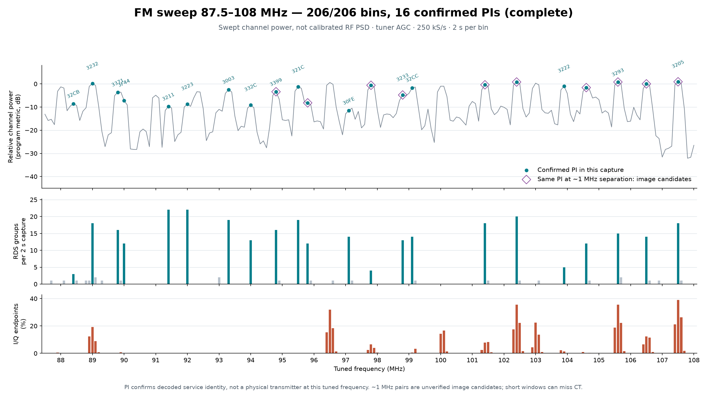
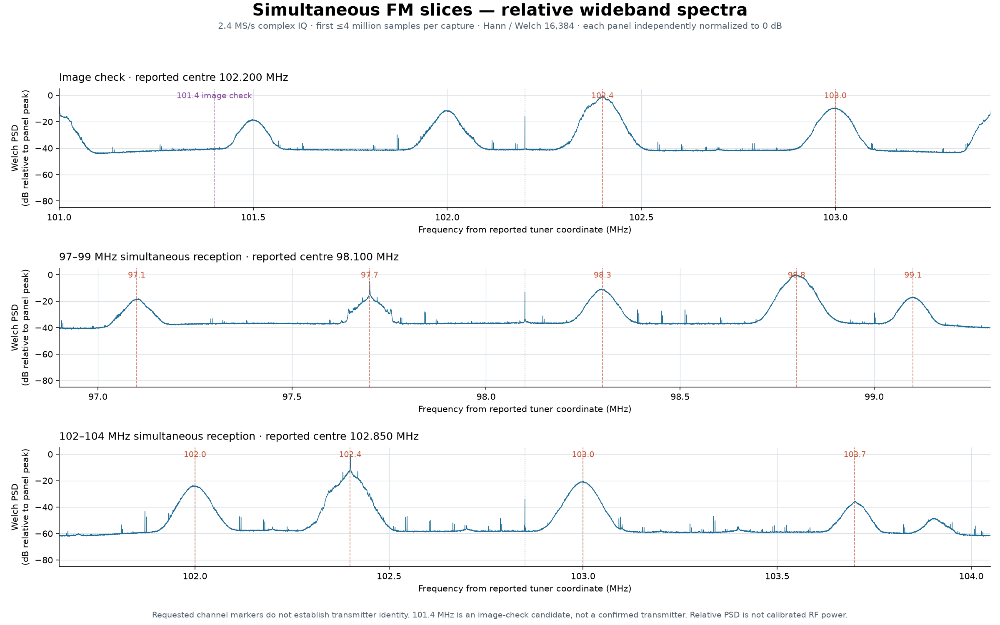

# Full-band FM demonstration — 2026-11-02

A live demonstration in Warsaw–Wilanów completed a **206-point FM sweep**,
three wideband captures with simultaneous channel reception, and a three-station
hopping run. The
sweep recovered **16 distinct confirmed PI codes**; the long hopping run
recovered Clock-Time on **all three stations**. All stages completed
successfully using the production CLI and one RTL-TCP receiver.

These are reception and decoding results. Received Clock-Time remained about
one hour ahead of host UTC, and some frequency assignments in the sweep remain
unresolved. The experiment does not establish accurate UTC or 16 independent
physical transmitters.

## Whole-band sweep

The scan covered 87.5–108.0 MHz in 100 kHz steps: **206/206 tuning points**,
two seconds per capture, 250 kS/s, tuner AGC enabled and digital AGC disabled. Each
retune included at least 0.3 seconds of active sample discard before capture.

- 22 tuning points contained confirmed PI values, representing 16 distinct PIs.
- Another 22 points contained groups without a confirmed PI.
- No Clock-Time was received in these short windows. This does not establish
  that the stations never transmit Group 4A.
- Some channels showed substantial I/Q endpoint occupancy under tuner AGC.
  Gain must be evaluated for the antenna and selected channels.



The power curve combines successive tunings. It is neither calibrated RF
power nor a simultaneous spectrum of the entire 20.5 MHz band. Confirmed PI
means repeated decoded programme identity, not authenticated source identity
or proof of a transmitter at the requested tuning frequency.

## Simultaneous reception within receiver bandwidth

Each WIDE capture contained **12 seconds at 2.4 MS/s**, or 28.8 million complex
samples. Channels within a capture share the same acquisition interval and
are extracted digitally. Decoding follows capture; this is not continuous
audio streaming. The separate wideband captures occurred sequentially.

| Capture centre | Gain | Channel, MHz | Confirmed PI | Groups | Interpretation |
|---:|---:|---:|---|---:|---|
| 98.100 MHz | 28 dB | 97.1 | — | 2 | Unconfirmed |
| 98.100 MHz | 28 dB | 97.7 | `0x32BE` | 4 | Few decoded groups |
| 98.100 MHz | 28 dB | 98.3 | `0x3245` | 136 | RMF Classic |
| 98.100 MHz | 28 dB | 98.8 | `0x3233` | 136 | PR Trójka |
| 98.100 MHz | 28 dB | 99.1 | — | 1 | Unconfirmed |
| 102.850 MHz | 28 dB | 102.0 | `0x33B1` | 136 | Eska ROCK |
| 102.850 MHz | 28 dB | 102.4 | `0x3211` | 136 | PR Jedynka |
| 102.850 MHz | 28 dB | 103.0 | `0x3A0A` | 137 | Radio Kolor |
| 102.850 MHz | 28 dB | 103.7 | — | 1 | Unconfirmed |

Eska ROCK, Jedynka and Kolor decoded from one shared capture; RMF Classic and
Trójka decoded from another. All three WIDE captures reported **0.00% I/Q
endpoint occupancy**. This does not prove an optimal gain for weak channels.



Each spectrum uses the first four million samples, a Hann window, 16,384-point
Welch segments and 50% overlap. Each panel is normalized to its own maximum,
so panels do not share an absolute power scale. Frequency coordinates use the
reported tuner centre and requested sample rate, without independent LO
calibration. Marked channels alone do not establish station identity.

## Unresolved frequency repetitions

The narrowband sweep recovered the same PI at five pairs separated by 1 MHz:
94.8/95.8, 97.8/98.8, 101.4/102.4, 104.6/105.6 and 106.5/107.5 MHz. These
are not counted as additional verified transmitters.

A separate WIDE capture centred at 102.200 MHz, with manual gain 19.7 dB,
gave the following simultaneous results:

| Channel, MHz | Confirmed PI | Groups |
|---:|---|---:|
| 101.4 | — | 0 |
| 102.4 | `0x3211` | 133 |
| 103.0 | `0x3A0A` | 136 |

The absence of decoded RDS at 101.4 MHz in this capture supports caution when
interpreting the sweep. It does not resolve whether RF/IF images, receiver
configuration or attribution during retuning caused the repetitions. No
automatic 1 MHz correction was applied.

## Hopping and Clock-Time

One TCP session visited three stations sequentially at 250 kS/s, using manual
gain 19.7 dB, 75-second captures and one second of active settling before each.
The complete command took approximately 244 seconds, including decoding.

| Channel, MHz | Confirmed PI | Groups | Last declared UTC, 2026-11-02 | CLI timestamp after decoding, host UTC |
|---:|---|---:|---|---|
| 102.4 | `0x3211` | 829 | 17:49 | 16:49:26 |
| 98.8 | `0x3233` | 643 | 17:50 | 16:50:47 |
| 107.5 | `0x3205` | 846 | 17:51 | 16:52:09 |

Clock-Time was received on **3/3 stations**, each declaring local time offset
zero. The CLI timestamp is taken after capture and decoding, so subtracting these columns
does not measure transport latency. The hour-scale disagreement with host UTC
remains evident. The declared time was preserved without subtracting an hour.

This validates sequential live reception and CT extraction. It does not
calibrate absolute time, authenticate the broadcasts or demonstrate that the
stations use independent clocks. See the earlier
[gain and timing validation](hardware-validation-2026-10-31.md) for independent
raw-field checks and the limits of the host reference.

## Repeat the acquisition

Prepare the checkout using the [demonstration guide](demo.md), then run from
the repository root:

```bash
export PYTHONPATH="$PWD/src"
```

Use exclusive access to an RTL-TCP receiver and an FM antenna. These commands
expect the receiver on loopback port 1234. For a remote receiver, forward its
loopback listener in a separate terminal:

```bash
ssh -N -L 1234:127.0.0.1:1234 SDR_HOST
```

Run the following commands sequentially. Frequencies and gains reproduce this
experiment's configuration; reception elsewhere is not guaranteed.

```bash
# Full-band survey: 412 seconds of samples, plus settling and decoding.
.venv/bin/python -u -m rdsclock scan --host 127.0.0.1 \
  --start 87.5 --end 108 --step 0.1 --duration 2 \
  --fs 250000 --settle-seconds 0.3

# Simultaneous check of the repeated-PI candidate.
.venv/bin/python -u -m rdsclock multi --host 127.0.0.1 \
  --mode wide --freqs 101.4,102.4,103.0 --fs 2400000 \
  --duration 12 --gain 19.7 --settle-seconds 1

# Two simultaneous reception windows, acquired one after the other.
.venv/bin/python -u -m rdsclock multi --host 127.0.0.1 \
  --mode wide --freqs 97.1,97.7,98.3,98.8,99.1 --fs 2400000 \
  --duration 12 --gain 28 --settle-seconds 1
.venv/bin/python -u -m rdsclock multi --host 127.0.0.1 \
  --mode wide --freqs 102.0,102.4,103.0,103.7 --fs 2400000 \
  --duration 12 --gain 28 --settle-seconds 1

# Separated stations: 75 seconds per station in one hopping session.
.venv/bin/python -u -m rdsclock multi --host 127.0.0.1 \
  --mode hop --freqs 102.4,98.8,107.5 \
  --duration 75 --gain 19.7 --settle-seconds 1
```

WIDE allocates about 230 MB for each 12-second complex64 capture before DSP
working arrays. The original runs also saved IQ locally for spectrum analysis;
the commands above omit recording to disk. RTL-TCP provides no hardware
timestamps or tuning acknowledgement, so active draining cannot establish
hardware-level capture timing.

## Evidence retained locally

The source artifacts are under the ignored `build/full-demo-20261102/`:
`full-band-scan.log`, `scan-results.json`, `demo-runs.json`, the three
`wide-*.log` files and `hop-clock-demo.log`. The parser recorded all 206 scan
points; the four follow-up commands each returned exit code zero. Plot methods
are recorded in `analyze_scan.py`, `plot_wide.py` and `wide-spectra.json`.

Those local artifacts are not distributed with a fresh checkout. This report
and its figures contain measurement aggregates only. Captured IQ, decoded
audio, RadioText, receiver addresses and private correspondence are excluded.
