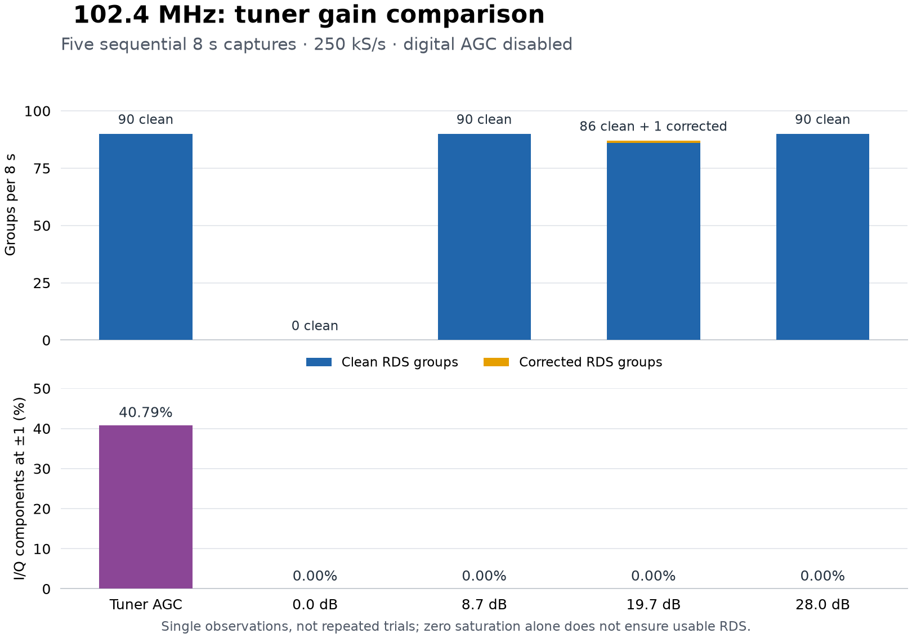

# Hardware validation — 2026-10-31

Live testing completed **19 captures on eight FM frequencies**, confirming six
distinct station PI codes. A subsequent 75-second capture recovered **855 clean
RDS groups and one Clock-Time message**. The received times substantially
disagreed with host UTC. These results demonstrate live reception and decoding;
they do not establish an accurate or independently calibrated clock.

## Setup and measurement boundaries

The client ran on Linux under WSL2, using Python 3.12.13, NumPy 2.5.4 and
SciPy 1.18.1. The remote `rtl_tcp` handshake reported tuner type 5, corresponding
to the R820T family, and 29 gain steps. It does not identify the exact dongle
revision or server library version. Sampling was 250,000 complex samples/s.

The gain experiment used the baseline implementation from revision
`af8c0a1e91566cb764c4141d7f9d309120e42214`, with a diagnostic capture harness:

- One connection handled all 19 eight-second captures.
- Direct sampling and RTL2832 digital AGC were explicitly disabled; PPM
  correction was reset to zero.
- After each frequency/gain change, incoming samples were actively consumed
  and discarded for three wall-clock seconds.
- Decoding began after recording finished and the receiver was released.

This method avoids leaving the receiver unread during decoding between tuning
steps. It still provides a host estimate of sample timing, not hardware
timestamps. The later 75-second CLI capture used the updated transport in the
working tree; it is reported separately below.

These are sequential, single observations per setting, not randomized or
repeated trials. The eight frequencies were selected test points, not a full
survey of the FM band. Different PI codes do not prove independent time sources.

## Gain and station reception



At 102.4 MHz, tuner AGC produced 90 clean groups despite 40.79% of I/Q
components reaching the range endpoints. Manual 8.7 dB and 28.0 dB each
produced 90 clean groups with no endpoint samples. Manual 19.7 dB produced
86 clean groups and one corrected group; manual 0 dB recovered no groups.
Thus 8.7 dB was a useful setting for this station and setup, not a universal
optimum.

The cross-frequency comparison shows why a fixed lower gain is insufficient.
Counts below are **clean / corrected groups per eight-second capture**.

| MHz | Confirmed PI | Tuner AGC | Manual 19.7 dB | I/Q endpoints with AGC |
|---:|---|---:|---:|---:|
| 91.0 | — | 2 / 0 | 0 / 0 | 0.720% |
| 94.0 | `0x332C` | 74 / 15 | 0 / 0 | 0% |
| 96.5 | `0x321C` | 90 / 0 | 40 / 27 | 34.158% |
| 98.8 | `0x3233` | 90 / 0 | 90 / 0 | 0.018% |
| 102.4 | `0x3211` | 90 / 0 | 86 / 1 | 40.793% |
| 103.0 | `0x3A0A` | 90 / 0 | 15 / 21 | 0.296% |
| 103.7 | — | 0 / 0 | 0 / 0 | 0% |
| 107.5 | `0x3205` | 90 / 0 | 90 / 0 | 40.983% |

All manual captures in this table had zero endpoint samples. Nevertheless,
19.7 dB lost reception at 94.0 MHz and reduced quality at 96.5 and 103.0 MHz.
At 103.0 MHz it also produced two singleton PI outliers alongside 34 groups
carrying the dominant PI. The two groups at 91.0 MHz did not meet the decoder's
three-group PI confirmation threshold. No RDS was recovered at 103.7 MHz in
either short capture; that does not establish that the frequency has no station.
Changing Programme Service text at a stable PI is compatible with dynamic PS.

Endpoint occupancy counts individual I and Q components equal to -1 or +1,
corresponding to original byte values 0 and 255. A large concentration there
is evidence consistent with saturation of the received stream, but does not
locate the limiting analog or digital stage. The reported power metric is
`10*log10(mean(I²+Q²))`; with each component in [-1, 1], its maximum is
+3.01 dB. Positive reported power alone is therefore not proof of clipping,
and the metric is not calibrated RF power.

Tuner AGC is separate from the RTL2832 digital AGC. The latter remained off
throughout this comparison. The manual values are nominal driver settings,
not measured gain at the antenna. See the upstream
[AGC API](https://github.com/osmocom/rtl-sdr/blob/master/include/rtl-sdr.h) and
[R82xx gain implementation](https://github.com/osmocom/rtl-sdr/blob/master/src/tuner_r82xx.c).

## Clock-Time: decoding succeeded, clock agreement did not

The baseline sweep received these 4A declarations; all dates are 2026-10-31.
The differences use the capture harness's estimated host receipt time.

| Service / MHz | PI | Declared UTC | Estimated host UTC | CT minus host | LTO |
|---|---|---|---|---:|---:|
| PR1 / 102.4 | `0x3211` | 10:43:00 | 09:43:01.104 | +3598.896 s | 0 min |
| PR3 / 98.8 | `0x3233` | 10:45:00 | 09:45:01.156 | +3598.844 s | 0 min |

An earlier 12-second PR1 recording independently confirmed the field
interpretation. Its 4A data words, before time parsing, were:

```text
A=3211  B=4461  C=DF40  D=A180
MJD = 61344 -> 2026-10-31
hour = 10; minute = 06; local offset = 0 minutes
```

Extracting these bits independently of the CT parser gave 10:06 UTC, while
the host was at approximately 09:06 UTC. The layout matches
[NRSC-4-B, Figure 20 and section 6.2.3](https://www.nrscstandards.org/standards-and-guidelines/documents/archive/nrsc-4-b-standard-2005.pdf#page=14):
the hour/minute field is UTC, with a separate local offset. The hour-scale
disagreement was already present in the received declaration, rather than
introduced by local-time formatting. It also appeared in the later PR1
capture without saturation.

The updated CLI then recorded **75 seconds at 107.5 MHz, manual 19.7 dB**:

- 18,750,000 IQ samples; reported power -22.4 dB; endpoint occupancy 0.00%.
- 855 clean groups, zero corrected groups; PI `0x3205` (Radio ZET).
- One 4A declaring 11:17 UTC, LTO zero.
- Reported CT-minus-host difference approximately **+3561 seconds**.

This last difference is not exactly the same as the approximately +3599-second
PR1/PR3 observations. None should be silently corrected by subtracting an hour.
The host reported NTP synchronization, and HTTP Date checks agreed with it at
the scale of seconds. That supports identifying gross disagreement, but is
not a traceable timing calibration. The tests do not establish the cause at
the broadcast source, subsecond accuracy, or independent multi-source UTC
agreement. Clean CRCs establish neither correct broadcast time nor source
authenticity; multiple services may share the same upstream time error.

## Engineering decisions supported by the evidence

1. **Separate connection, sample freshness, decoding and clock trust.** Earlier
   attempts encountered header timeouts and connection resets. A correct CRC
   does not establish that buffered samples belong to the newly requested
   frequency. Active draining, bounded failure handling and PI checks address
   separate parts of that problem. The complete sweep and long capture are
   successful runs, not a reconnect reliability certification.
2. **Tune gain against useful output.** Compare clean groups/s, correction
   counts, endpoint occupancy and PI stability. Removing endpoint samples alone
   can leave an undecodable weak signal, as the 0 dB and 94.0 MHz trials show.
   Repeat candidate settings before claiming an optimum.
3. **Preserve source identity and receipt time.** Keep fields from different
   PI codes separate, avoid counting adjacent frequencies carrying the same
   PI as independent clocks, and anchor time estimates to receipt rather than
   decoder completion. Report host disagreement explicitly instead of changing
   the received UTC declaration.

The next useful timing experiment is a repeated capture spanning several
minute boundaries on more than one service, with independently characterized
reference and transport timing. This report does not claim that experiment
has been completed.

## Evidence and reproducibility

The initial offline suite passed **289 tests, with 10 deselected**, at the
starting revision. That is a software baseline, separate from the live
measurements above and from subsequent tests of the fixes.

The following local artifacts supplied the reported aggregates:

- `build/sdr-audit-20261031/gain-baseline-complete/results.json` and
  `capture-status.json` — 19 planned, 19 completed, no capture error.
- `build/sdr-audit-20261031/compare_gain.py` — diagnostic capture method.
- `build/sdr-audit-20261031/ct-validation/107p5-75s.log` — updated CLI capture.
- `build/sdr-check-20261031/raw-clock-review.json` — independent bit extraction.
- `build/sdr-check-20261031/offline-tests.log` — initial software baseline.

These ignored local artifacts are not part of a fresh checkout. The tables
and figure publish only measurement aggregates; captured IQ, decoded audio,
RadioText, private addresses and operator identifiers are not included.

To repeat a long capture with the updated CLI, supply your receiver address
and choose a locally audible frequency:

```bash
mkdir -p build
PYTHONPATH=src .venv/bin/python -u -m rdsclock live \
  --host SDR_HOST --port 1234 --freq 107.5 --gain 19.7 \
  --duration 75 --save build/validation.iq -v
```

Use exclusive receiver access, preserve the raw declared CT, and record the
capture configuration alongside the result. Local reception conditions and
server behavior can change the outcome.

## Follow-up software validation — 2026-11-02

The repaired working tree passed **329 software tests**, including slow
synthetic and offline-consensus checks, with warnings treated as errors.
One test explicitly skipped its optional local 300-second IQ baseline because
that recording is not distributed with a checkout. Three live-hardware tests
were deselected; this result does not count them as passes. Ruff and Black
checks also passed.

The deterministic end-to-end demonstration recovered the expected Clock-Time
for all three generated stations. A separate consensus example confirmed that
repeated PI values do not add votes and that an isolated ten-minute error is
reported as an outlier. See [the demonstration guide](demo.md).

After restoring exclusive receiver access and completing a server restart,
the updated production CLI completed a three-station HOP run on November 2.
One TCP connection covered three eight-second captures, with one second of
active settling before each and manual gain 19.7 dB:

| MHz | Confirmed PI | Decoded groups |
|---:|---|---:|
| 102.4 | `0x3211` | 91 |
| 98.8 | `0x3233` | 74 |
| 107.5 | `0x3205` | 90 |

The process exited successfully and each requested channel produced its own
expected PI. No Clock-Time was observed in these short snapshots; this result
validates live retuning and station attribution, not absolute UTC agreement.
The local acceptance log is `build/final-validation/live-hop.log`.

Two subsequent independent CLI connections also succeeded: an eight-second
102.4 MHz capture recovered 90 groups (88 clean, two corrected), and an
eight-second 98.8 MHz capture recovered 88 (82 clean, six corrected). Both used
manual 19.7 dB, had zero endpoint samples and reported the expected PI.
Together with HOP, this verifies three sequential successful TCP sessions of
the updated client. The local log is
`build/final-validation/reconnect-after-hop.log`; it is a bounded acceptance
test, not long-term server reliability certification.

Earlier acquisition failures occurred while the receiver was occupied or
retained closed connections. A subsequent partial attempt was interrupted
when systemd began stopping `rtl_tcp`; it is not included as a successful run.
Receiver exclusivity and server lifecycle are operational preconditions for
the demonstration.
